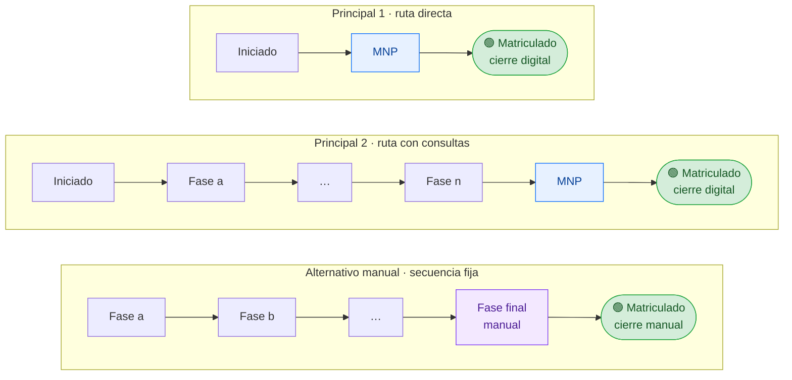
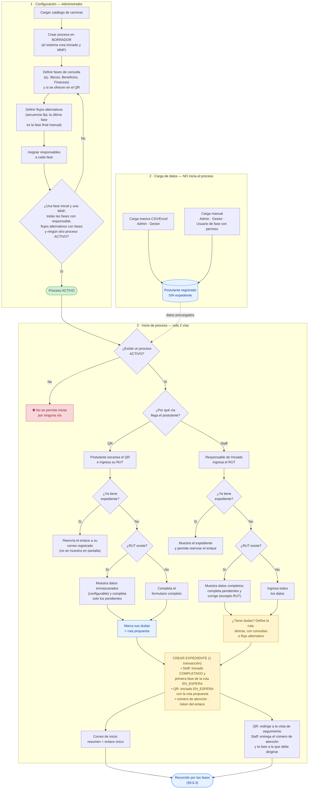
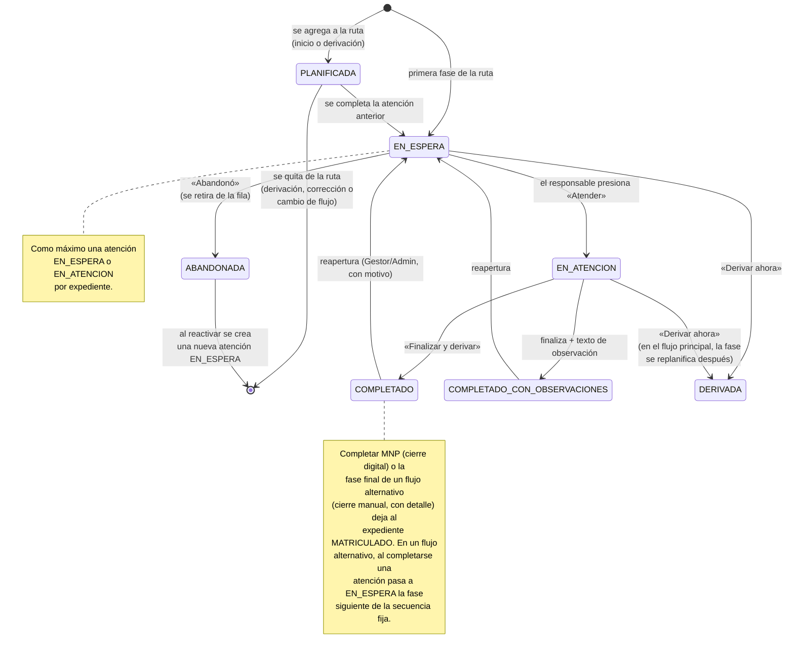
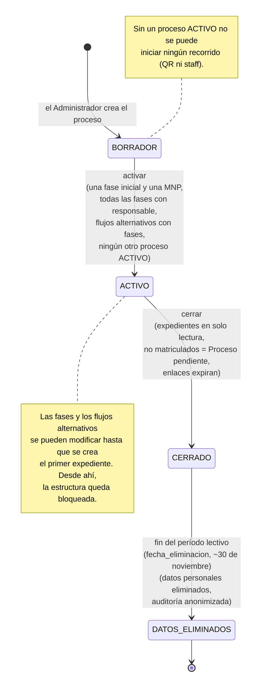

# SPEC — Sistema WorkFlow

> Versión: 0.8 · Fecha: 2026-10-17 · Estado: aprobada (recorrido dinámico y flujos alternativos)
>
> **Cambios v0.8 (recorrido dinámico por fases):**
> - El workflow deja de ser una secuencia fija. Cada postulante sigue una **ruta propia**: fase inicial → cero o más **fases de consulta** → **fase MNP**, donde idealmente completa la matrícula en forma digital, asistido en un tótem (RF-12).
> - Hay dos variantes del **flujo principal**: **Principal 1 · ruta directa** (Iniciado → MNP), cuando el postulante no tiene dudas, y **Principal 2 · ruta con consultas** (Iniciado → Becas → … → MNP), cuando tiene dudas sobre becas, beneficios, pago u otros temas.
> - **Cada fase puede cambiar el flujo:** al terminar una atención, el responsable define la fase siguiente (derivación). En la fase inicial se pregunta explícitamente si el postulante tiene dudas (RF-14).
> - Se elimina el orden secuencial obligatorio (antigua RF-14). El `orden` de las fases pasa a ser solo de presentación.
> - Nuevos estados de atención: `PLANIFICADA`, `EN_ESPERA`, `EN_ATENCION`, `COMPLETADO`, `COMPLETADO_CON_OBSERVACIONES`, `DERIVADA` y `ABANDONADA`. Se registran la llegada a la fila, el inicio y el fin de cada atención (RF-13).
> - El proceso queda **completado (Matriculado)** al completarse la fase MNP (**cierre digital**) en el flujo principal, o al completarse la fase final de un **flujo alternativo manual** (**cierre manual**) (RF-16, RF-29).
> - **MNP no es la fase final para todos.** Es la fase de sistema de **cierre digital** (tipo `CIERRE_DIGITAL`) y el destino del flujo principal. Si un caso no puede terminar en MNP (ej.: pago en efectivo y firma manual del contrato), se deriva a un **flujo alternativo manual**: una secuencia completa y fija de fases, definida por el Administrador, cuya última fase es la **fase final manual**. Puede haber varios flujos alternativos por proceso, y se puede entrar a ellos desde cualquier fase del flujo principal (RF-03, RF-29).
> - El estado, las fases completadas, la actual y la siguiente se ven en el móvil del postulante y en la pantalla de los responsables, que se actualizan cada 10 s (RF-15, RF-17, RF-20).
> - Reportería ampliada: tiempos de espera y de atención por fase, postulantes pendientes, matriculados y matriculados con observaciones, atención por fase y postulantes en espera (RF-18).
> - Correcciones de la ruta y reapertura de atenciones por Gestor y Administrador (RF-27).
> - En el modelo de datos, `atencion` reemplaza a `expediente_fase` y `fase` incorpora `tipo` y `mostrar_en_qr`. Se agregan `flujo_alternativo` y `flujo_alternativo_fase`, y `expediente` registra el flujo en curso y el tipo de cierre (§8).
> - Diagramas de la §9.6 actualizados: flujos del proceso, configuración e inicio, recorrido por las fases, estados de una atención y estados del proceso.
> - En el QR, el postulante indica si tiene dudas y sobre qué temas. El staff de la fase inicial confirma o ajusta la ruta (RF-10).
> - Si el postulante abandona la fila, se marca como **"Abandonó"** y puede reactivarse si vuelve (RF-28).
> - Las preguntas del nuevo flujo quedaron resueltas (§13). **MNP** significa **Matrícula No Presencial**: la plataforma web de matrícula de la universidad, que el postulante usa asistido en un tótem.
>
> **Cambios v0.7 (revisión técnica previa al desarrollo):**
> - El número de atención es **correlativo por proceso**, sin reinicio diario, único por proceso, y guarda la fecha y hora de asignación para estadísticas (RF-19).
> - El mínimo de un responsable por fase se exige al activar el proceso y mientras esté ACTIVO, no durante la configuración en BORRADOR (RF-04).
> - Eliminar una fase que deja a un Usuario de fase sin fases se rechaza (§4).
> - Los postulantes sin expediente tienen su propia fecha de eliminación (`eliminar_en`) (RF-26).
> - `proceso_resumen` con clave propia y momento de generación definido. `expediente_fase` con `UNIQUE(expediente_id, fase_id)`.
> - Límite de reenvíos del enlace por expediente (RF-10, RF-21).
> - Cambios de estado con bloqueo de la fila del expediente (`SELECT … FOR UPDATE`), además del bloqueo optimista (RNF-06).
> - Bloqueo de login de 15 minutos. Flask-Limiter usa Redis, compartido por los workers (§7).
> - Se mantiene configurable `enmascarar_datos_qr` (decisión explícita del usuario).
> - Componentes de firmaDocs se implementan desde cero, siguiendo sus convenciones. Desarrollo local con Docker Desktop.
>
> **Cambios v0.6 (revisión final):**
> - Se agregan diagramas de flujo y de estados (§9.6).
> - Al cerrar un proceso, los expedientes sin todas las fases completas quedan como **"Proceso pendiente"**.
> - **Precondición obligatoria:** sin un proceso ACTIVO, configurado con sus fases y responsables, no se puede iniciar ningún recorrido, por ninguna vía.
> - **Conservación de datos:** los datos viven solo durante el período lectivo, **de enero a noviembre aproximadamente**, y luego se eliminan (RF-26).
> - Se corrige un criterio de aceptación que contradecía la corrección de datos por el staff.
> - Se retiran del documento las credenciales SMTP: viven solo en el `.env`.
>
> **Cambios v0.5:**
> - Un solo teléfono por postulante (columna `telefono_postulante`).
> - Las carreras se eligen de un **catálogo por código** que mantiene el Administrador (RF-25).
> - El responsable de "Iniciado" puede **corregir datos** durante el inicio (excepto el RUT), con auditoría.
> - Un solo proceso activo a la vez.
> - Se envía un correo al quedar **Matriculado**, desde una cuenta no-reply.
> - El Gestor consulta la auditoría de expedientes y postulantes en modo de solo lectura.
> - Volumen de referencia: 2.500 postulantes y 40 usuarios concurrentes.
> - Se confirman los límites de la carga masiva y la política de contraseñas.
>
> **Cambios v0.4:**
> - Se separan dos conceptos que no deben confundirse:
>   - **Carga de datos** (§5.2): registrar postulantes, manual o masivamente, **sin** iniciar su proceso.
>   - **Inicio de proceso** (§5.3): crear el expediente del postulante y completar la fase "Iniciado".
> - El proceso de un postulante se inicia **solo de dos formas**: por QR (autoinicio) o por el staff que lo recibe. Ambas están en fase 1.
> - Inician procesos los **responsables de la fase "Iniciado"**, como en cualquier otra fase.
> - El permiso `puede_registrar_postulantes` aplica **solo a la carga manual**.
> - En el QR, si el RUT existe, se despliegan sus datos para completar los pendientes, **enmascarados por defecto**. El enmascaramiento es configurable (sí/no).
>
> **Cambios v0.3:** correo personal obligatorio y envío del enlace de seguimiento · una sola sede · formato del archivo de precarga · bloqueo de la estructura de fases al iniciar el workflow.
> **Cambios v0.2:** orden secuencial obligatorio · "Completado con observaciones" cuenta como completado · usuarios propios (SSO Google después) · stack de firmaDocs.

---

## 1. Objetivo

Sistema web para **definir, configurar y mantener workflows** compuestos por fases, y para **registrar el recorrido de cada postulante** a través de esas fases. Cada fase tiene usuarios responsables, que atienden al postulante y deciden a qué fase debe continuar. El recorrido no es fijo: depende de las dudas de cada postulante.

El caso de uso inicial es el **proceso de matrícula**. Aun así, el modelo debe ser genérico para poder reutilizarse en otros procesos, como admisión, titulación o beneficios. El sistema opera para **una sola sede**.

## 2. Alcance

### 2.1 Dentro del alcance

- Configuración de procesos (workflows) y de sus fases: identificador, descripción y orden.
- Asignación de usuarios responsables a cada fase.
- Catálogo de carreras.
- **Carga de datos de postulantes**: masiva desde CSV o Excel, y manual.
- **Inicio de proceso** por dos vías: autoinicio por QR, o inicio por el staff que recibe al postulante.
- Búsqueda de postulantes por RUT.
- Recorrido dinámico del postulante por las fases: fase inicial, fases de consulta según sus dudas y fase MNP (cierre digital), con derivación entre fases, y flujos alternativos manuales para los casos que no pueden terminar en MNP.
- Registro de los tiempos de espera y de atención en cada fase.
- Envío por correo al postulante del resumen del proceso y de su enlace único de seguimiento.
- Vista de seguimiento del postulante, a la que se accede con el enlace único.
- Tres roles con permisos diferenciados: Administrador, Gestor y Usuario de fase.
- Autenticación con usuarios propios del sistema (correo y contraseña).
- Auditoría completa de las acciones de los usuarios del sistema.
- Reportería para Gestor y Administrador.

### 2.2 Fuera del alcance (por ahora)

- **SSO con Google.** Se implementará en una etapa posterior, pero el modelo de usuarios queda preparado para ello (ver RF-22).
- Varias sedes o unidades (multi-tenant).
- Integración de pagos (la fase Finanzas solo registra el estado, no procesa pagos).
- Firma electrónica de contratos.
- Notificaciones por SMS o WhatsApp, y correos en cada cambio de fase (ver §12).
- Integración en línea con sistemas académicos externos. La carga de postulantes es por archivo (RF-08).
- Integración con la plataforma MNP (Matrícula No Presencial) o con el tótem donde se usa. El sistema solo registra el resultado que marca el responsable de MNP (RF-03).

## 3. Glosario

| Término | Definición |
|---|---|
| **Proceso / Workflow** | Conjunto de fases por las que puede pasar un postulante (ej.: "Matrícula 2027"). Tiene una fase inicial, una fase de cierre digital (MNP), cero o más fases de consulta y cero o más flujos alternativos. |
| **Proceso iniciado** | Proceso que ya tiene al menos un expediente creado. Su estructura de fases queda bloqueada (RF-05). |
| **Fase** | Lugar de atención del proceso (ej.: Iniciado, Becas, Finanzas, MNP). Tiene identificador, descripción, tipo, orden de presentación y responsables. |
| **Fase inicial ("Iniciado")** | Fase de sistema donde el staff recibe al postulante, inicia su proceso y pregunta si tiene dudas para definir su ruta (RF-03, RF-14). |
| **Fase de consulta** | Fase opcional donde el postulante aclara dudas (ej.: Becas, Beneficios, Finanzas). Solo la visita si fue derivado a ella. |
| **Fase de cierre digital (MNP)** | Fase de sistema, obligatoria, donde el postulante completa la matrícula en la plataforma web **MNP (Matrícula No Presencial)**, asistido en un tótem. Es el destino del flujo principal y donde idealmente concluye el proceso, pero no es la fase final para todos (ver flujo alternativo). Al completarla, queda Matriculado (RF-03, RF-16). |
| **Flujo principal** | Recorrido que termina en MNP: Iniciado → MNP (ruta directa) o Iniciado → fases de consulta → MNP (ruta con consultas). Es dinámico: cada fase puede cambiar la ruta (RF-12, RF-14). |
| **Flujo alternativo (manual)** | Secuencia completa y fija de fases, definida por el Administrador, para los casos que no pueden terminar en MNP (ej.: "Pago en efectivo": Finanzas → Caja → Firma de contrato). Su última fase es la fase final manual. Un proceso puede tener varios (RF-29). |
| **Fase final manual** | Última fase de un flujo alternativo. Al completarla, con el detalle del cierre, el expediente queda Matriculado por **cierre manual**, fuera de MNP (RF-29). |
| **Ruta** | Secuencia de atenciones de un expediente: empieza en la fase inicial, sigue con las fases de consulta que correspondan y termina en MNP (flujo principal) o en la fase final manual de un flujo alternativo. Es propia de cada postulante y puede cambiar durante el recorrido (RF-12). |
| **Ruta directa (Principal 1)** | Ruta sin fases de consulta: Iniciado → MNP. |
| **Ruta con consultas (Principal 2)** | Ruta con una o más fases de consulta entre Iniciado y MNP. |
| **Atención** | Paso de la ruta: la visita del postulante a una fase. Registra su estado y los tiempos de espera y de atención (RF-13). Una misma fase puede tener más de una atención en la ruta. |
| **Estado de atención** | `PLANIFICADA`, `EN_ESPERA`, `EN_ATENCION`, `COMPLETADO`, `COMPLETADO_CON_OBSERVACIONES`, `DERIVADA` o `ABANDONADA` (RF-13). |
| **Abandono** | Estado del expediente cuando el postulante se retira de la fila sin ser atendido. Se puede reactivar si vuelve (RF-28). |
| **Derivación** | Acción con que el responsable de una fase define o cambia las fases siguientes de la ruta (RF-14). |
| **Fase actual** | Fase de la atención que está `EN_ESPERA` o `EN_ATENCION`: donde el postulante debe estar. |
| **Fase siguiente** | Fase de la primera atención `PLANIFICADA` después de la fase actual. |
| **Tiempo de espera** | Tiempo entre que el postulante queda `EN_ESPERA` en una fase y el inicio de su atención. |
| **Tiempo de atención** | Tiempo entre el inicio y el fin de una atención. |
| **Postulante** | Persona que recorre el proceso. Se identifica por su RUT. |
| **Carga de datos** | Registro de los datos de un postulante, manual o masivo. **No inicia su proceso** ni crea expediente. |
| **Inicio de proceso** | Acción que crea el expediente del postulante. Se hace **solo** por QR o por un responsable de la fase inicial. |
| **Carreras de interés** | Hasta tres carreras del postulante, en orden de preferencia, elegidas del catálogo (RF-25). La primera es obligatoria. |
| **Expediente** | Instancia de un proceso para un postulante concreto. Contiene su ruta y sus atenciones. |
| **Matriculado** | Estado final del expediente cuando se completa la fase MNP (cierre digital) o la fase final manual de un flujo alternativo (cierre manual, RF-29). Si alguna atención terminó con observaciones, queda como "Matriculado con observaciones" para efectos de reportería (RF-16). |
| **Proceso pendiente** | Estado final de un expediente que no quedó Matriculado cuando se cerró el proceso (RF-16). |
| **Enlace de seguimiento** | URL única y no adivinable con la que el postulante ve su recorrido (RF-20). Se envía por correo y es la misma que se obtiene por QR. |
| **Número de atención** | Código correlativo que se entrega al postulante al iniciar el proceso (ej.: `M-0042`). |
| **Responsable** | Usuario del sistema asignado a una fase. Atiende a los postulantes en esa fase y los deriva. Los responsables de la fase inicial son quienes inician procesos. |

## 4. Roles y permisos

| Acción | Administrador | Gestor | Usuario de fase |
|---|:-:|:-:|:-:|
| Gestionar usuarios y roles | ✅ | ❌ | ❌ |
| Habilitar o deshabilitar la carga manual a un Usuario de fase | ✅ | ❌ | ❌ |
| Crear, editar y ordenar procesos y fases (solo si el proceso no está iniciado) | ✅ | ❌ | ❌ |
| Configurar el enmascaramiento de datos del QR | ✅ | ❌ | ❌ |
| Asignar responsables a fases | ✅ | ❌ | ❌ |
| Mantener el catálogo de carreras | ✅ | ❌ | ❌ |
| **Carga de datos:** masiva (CSV/Excel) | ✅ | ✅ | ❌ |
| **Carga de datos:** manual | ✅ | ✅ | ⚙️ (*) |
| Editar datos ya registrados de postulantes (excepto RUT) | ✅ | ✅ | 🧩 (**) |
| **Inicio de proceso** (staff) | ✅ | ✅ | 🧩 (**) |
| Buscar postulante y ver todas sus fases y estados | ✅ | ✅ | ✅ |
| Reenviar el correo con el enlace de seguimiento | ✅ | ✅ | ✅ |
| Atender, finalizar y derivar en **cualquier** fase | ✅ | ✅ | ❌ |
| Atender, finalizar y derivar en **sus** fases | ✅ | ✅ | ✅ |
| Configurar flujos alternativos (RF-29) | ✅ | ❌ | ❌ |
| Derivar a un flujo alternativo o devolver al flujo principal (RF-29) | ✅ | ✅ | ✅ (solo desde su fase actual) |
| Corregir la ruta y reabrir atenciones (RF-27) | ✅ | ✅ | ❌ |
| Marcar "Abandonó" y reactivar (RF-28) | ✅ | ✅ | 🧩 (****) |
| Acceder a reportería | ✅ | ✅ | ❌ |
| Consultar la auditoría | ✅ completa | 👁️ (***) | ❌ |

(\*) ⚙️ Solo si el Administrador le habilitó el permiso `puede_registrar_postulantes`. **Por defecto está deshabilitado.**
(\*\*) 🧩 Solo si es **responsable de la fase "Iniciado"** del proceso activo. Es coherente con la regla general de que cada usuario actúa sobre sus fases. La edición de datos la puede hacer solo **durante el inicio de proceso** (RF-09).
(\*\*\*) 👁️ Solo lectura, y solo la auditoría de expedientes y postulantes: inicios, atenciones, derivaciones, cargas, ediciones de datos y correos. No ve la auditoría de configuración, usuarios ni sesiones (RF-24).
(\*\*\*\*) 🧩 Solo en la fase actual del expediente, si es responsable de ella. También puede reactivar el responsable de "Iniciado".

**Regla:** todo usuario con rol *Usuario de fase* debe tener **al menos una fase asignada**. El sistema no permite guardar un usuario de fase sin fases, ni quitarle su última fase, ni eliminar una fase que sea la última de algún usuario (se informa qué usuarios deben reasignarse antes). La regla **no aplica** al Administrador ni al Gestor, que ya pueden actuar sobre todas las fases.

## 5. Requerimientos funcionales

### 5.1 Configuración de procesos y fases (Administrador)

**RF-01 — Gestión de procesos.** El Administrador puede crear, editar, activar y cerrar procesos (ej.: "Matrícula 2027").
- Atributos: `código`, `nombre`, `descripción`, `fecha_inicio`, `fecha_fin`, `prefijo_atencion`, `enmascarar_datos_qr` (sí/no, **por defecto sí**, ver RF-10) y `estado`.
- Estados del proceso:
  - **BORRADOR**: en configuración. No acepta inicios de proceso.
  - **ACTIVO**: acepta inicios de proceso.
  - **CERRADO**: no acepta inicios, atenciones ni derivaciones, y los enlaces de seguimiento expiran. Al cerrar, todos sus expedientes quedan cerrados (`cerrado_en`) y en modo de solo lectura, con el estado global que tenían en ese momento. Los que no quedaron Matriculados quedan con estado **"Proceso pendiente"** (RF-16) y siguen disponibles en la reportería hasta la eliminación de los datos (RF-26). El cierre exige una confirmación que indica cuántos expedientes quedarán como "Proceso pendiente".
- Solo puede haber **un proceso ACTIVO a la vez**. El QR y el inicio por staff usan siempre ese proceso, sin que haya que elegirlo. Para activar un proceso, el que esté activo debe cerrarse antes.
- Para activar un proceso, este debe tener exactamente una fase inicial, exactamente una fase de cierre digital (MNP), todas sus fases deben tener al menos un responsable y cada flujo alternativo activo debe tener al menos una fase (RF-29).

**RF-02 — Gestión de fases.** Dentro de un proceso, el Administrador puede crear, editar, reordenar y eliminar fases, con las restricciones de RF-05.
- Atributos obligatorios: `identificador` (código único dentro del proceso, ej.: `BEC`), `nombre`, `descripción`, `tipo` y `orden` (entero, único dentro del proceso). Las fases de consulta tienen además `mostrar_en_qr` (sí/no, por defecto sí): indica si se ofrecen como tema de duda en el formulario QR (RF-10). Las fases que solo se usan en flujos alternativos (ej.: Caja, Firma de contrato) se configuran con "no".
- Tipos de fase:
  - **INICIAL**: una por proceso, de sistema (RF-03).
  - **CONSULTA**: cero o más. Son opcionales para el postulante: solo las visita si lo derivan a ellas (ej.: Becas, Beneficios, Finanzas). También son las fases que componen los flujos alternativos (RF-29). Una misma fase puede usarse como consulta en el flujo principal y en uno o más flujos alternativos, con los mismos responsables y la misma bandeja.
  - **CIERRE_DIGITAL**: una por proceso, de sistema. En matrícula es MNP (RF-03).
- El `orden` **ya no define la secuencia del recorrido**: se usa para presentar las fases en las pantallas y como orden sugerido al elegir fases de consulta. La secuencia real la define la ruta de cada postulante (RF-12).

**RF-03 — Fases de sistema: inicial y de cierre digital (MNP).** Todo proceso tiene dos fases de sistema que no se pueden eliminar ni cambiar de tipo:
- **Fase inicial "Iniciado"** (tipo INICIAL, se presenta primero):
  - Sus responsables son los usuarios del staff que reciben a los postulantes, inician su proceso (RF-09) y les preguntan si tienen dudas para definir su ruta (RF-14).
  - Es siempre la primera atención de la ruta.
  - Su atención completada no se puede revertir, porque equivale a la existencia del expediente. Si la ruta quedó mal definida, se corrige (RF-27).
- **Fase de cierre digital** (tipo CIERRE_DIGITAL, se presenta al final). En el proceso de matrícula es la fase **MNP (Matrícula No Presencial)**, cuyo identificador y nombre son configurables:
  - Allí el postulante completa la matrícula en la plataforma web MNP, asistido por el staff en un tótem. El sistema no se integra con la plataforma MNP: el responsable de la fase registra el resultado (§2.2).
  - Es el **destino del flujo principal**: mientras el expediente está en el flujo principal, la ruta planificada siempre termina en MNP, y no se puede quitar de ella.
  - **No es necesariamente la última fase del postulante.** Si no hay dificultades, pasa de "Iniciado" directamente a MNP, donde idealmente concluye el proceso. Si tiene dudas o dificultades, primero lo derivan a las fases de consulta idóneas y luego vuelve a MNP. Si el caso no puede terminar en MNP, se deriva a un **flujo alternativo manual** (RF-29): en ese caso MNP sale de la ruta y el proceso concluye en la fase final manual de ese flujo.
  - Al completarse su atención, el expediente queda **Matriculado** por cierre digital (RF-16).

**RF-04 — Asignación de responsables.** Cada fase tiene **uno o más** usuarios responsables, y un usuario puede ser responsable de **una o más** fases (relación N:M).
- Los responsables se pueden cambiar en cualquier momento, incluso con el proceso iniciado (por ejemplo, por reemplazo de personal).
- En BORRADOR, una fase puede quedar temporalmente sin responsables mientras se configura. Para activar el proceso, y mientras esté ACTIVO, cada fase debe tener al menos un responsable: no se puede quitar el último responsable de una fase ni desactivar a un usuario que sea el único responsable de una fase de un proceso ACTIVO.

**RF-05 — Bloqueo de la estructura del workflow.** Un proceso se considera **iniciado** desde que se crea su primer expediente.
- **Proceso no iniciado** (nuevo, o existente sin expedientes): se pueden agregar, eliminar y reordenar fases libremente.
- **Proceso iniciado:** **no se pueden** agregar ni eliminar fases, ni cambiar su tipo. Los controles correspondientes se ocultan en la interfaz, y el servidor rechaza el intento.
- En un proceso iniciado solo se pueden modificar aspectos que no alteran las rutas existentes: nombre y descripción de las fases, orden de presentación, `mostrar_en_qr`, nombre y descripción de los flujos alternativos, y descripción del proceso. Tampoco se pueden crear ni eliminar flujos alternativos, ni cambiar sus fases o su orden (RF-29). Estos cambios quedan auditados.
- Si se necesita otra estructura, se crea un proceso nuevo, idealmente clonando el existente (ver §12).

### 5.2 Carga de datos de postulantes

> Este módulo **solo registra o actualiza datos** de postulantes. **No inicia su proceso, no crea expedientes ni envía correos.** El inicio del proceso se describe en la §5.3.

**RF-06 — Datos del postulante.** Son los mismos en todas las vías: carga manual, carga masiva, inicio por staff e inicio por QR.

| Campo | Columna en archivo | Tipo | Obligatorio | Validación |
|---|---|---|:-:|---|
| RUT | `rut_postulante` | String | ✅ | Dígito verificador válido (módulo 11), único. Se acepta con o sin puntos y guion, y se normaliza a `12345678-9` |
| Nombres | `nombres_postulante` | String | ✅ | No vacío, máx. 100 caracteres |
| Apellidos | `apellidos_postulante` | String | ✅ | No vacío, máx. 100 caracteres |
| Teléfono | `telefono_postulante` | String | ✅ | Un solo número, de 8 a 15 dígitos, con `+` opcional. Se ignoran espacios y guiones |
| Correo personal | `correo_personal_postulante` | String | ✅ | Formato de correo válido |
| Carrera 1 | `carrera1_postulante` | String | ✅ | **Código** de una carrera activa del catálogo (RF-25) |
| Carrera 2 | `carrera2_postulante` | String | ❌ | Código de una carrera activa del catálogo |
| Carrera 3 | `carrera3_postulante` | String | ❌ | Código de una carrera activa del catálogo. Requiere Carrera 2 |

- Las carreras deben ser distintas entre sí.
- En los formularios (carga manual, inicio por staff y QR), las carreras se eligen de una **lista desplegable** del catálogo, que muestra el nombre y guarda el código. Solo en el archivo de carga masiva se escribe el código.
- El RUT no se puede editar una vez creado el postulante. Si hubo un error, el postulante se desactiva y se crea uno nuevo.

**RF-07 — Carga manual.** Registro de un postulante desde un formulario, sin iniciar su proceso. Sirve, por ejemplo, para dejar registrado a un postulante que llegó fuera de la precarga.
- **Quién:** Administrador y Gestor siempre. Usuario de fase solo con el permiso `puede_registrar_postulantes` (RF-23).
- **Edición** de postulantes ya registrados: Administrador y Gestor, en cualquier momento. Los responsables de "Iniciado" también pueden corregir datos, pero solo durante el inicio de proceso (RF-09).

**RF-08 — Carga masiva desde CSV o Excel.** El Administrador y el Gestor pueden precargar postulantes desde un archivo `.csv` o `.xlsx`, con las columnas de RF-06.

**Reglas del archivo:**
- La primera fila contiene los encabezados. Los nombres de columna **no distinguen mayúsculas de minúsculas** y se ignoran los espacios al inicio y al final.
- Los encabezados van **sin tildes**. Por compatibilidad, también se aceptan `telefonos_postulante` y `teléfonos_postulante` como alias de `telefono_postulante`.
- El orden de las columnas es libre. Si falta una columna obligatoria, el archivo se rechaza completo con un mensaje que indica cuál falta. Las columnas adicionales se ignoran.
- **CSV:** codificación UTF-8 (con o sin BOM). El separador `,` o `;` se detecta automáticamente, porque Excel en configuración regional chilena exporta con `;`.
- **Excel:** se lee solo la primera hoja. Todas las celdas se leen como texto, para no perder ceros ni dígitos verificadores `K`.
- Se puede descargar una **plantilla** (`.xlsx` y `.csv`) con estas columnas y una fila de ejemplo. La plantilla `.xlsx` incluye una segunda hoja, "Carreras", con el catálogo vigente (código y nombre) como referencia. Esa hoja no se importa.

**Proceso de carga:**
- **Validación previa:** antes de guardar, el sistema muestra una vista previa con tres grupos:
  - **Nuevos**: RUT válidos que no existen en la base.
  - **Existentes**: RUT ya registrados. Se muestran los datos que cambiarían.
  - **Con errores**: RUT inválido, campo obligatorio vacío, correo o teléfono mal formado, código de carrera inexistente o inactivo, o RUT duplicado dentro del archivo. Cada fila indica el número de fila y el motivo.
- Para los existentes, quien carga elige entre **no modificar** (opción por defecto), **completar solo los campos vacíos** o **sobrescribir**.
- Las filas con errores no se importan, pero no impiden importar las filas válidas.
- Al confirmar, la importación se ejecuta en una sola transacción. Al terminar se muestra un resumen (creados, actualizados, omitidos y con error) y se puede descargar el detalle de errores en CSV.
- Límites: hasta **10 MB y 20.000 filas** por archivo.

### 5.3 Inicio de proceso

> El proceso de un postulante se inicia **únicamente** por una de estas dos vías. Ambas terminan en la creación del expediente (RF-11). La carga de datos (§5.2) **nunca** inicia un proceso.
>
> **Precondición obligatoria para ambas vías:** debe existir un proceso en estado **ACTIVO**, es decir, configurado con sus fases, con responsables en todas ellas y activado por el Administrador (RF-01). Si no existe, **no se puede iniciar ningún recorrido por ninguna vía**: ni QR, ni staff, ni llamadas directas a la API. El servidor valida esta condición en cada intento, dentro de la misma transacción que crea el expediente.

**RF-09 — Inicio por staff.** Un usuario del staff recibe al postulante e inicia su proceso desde la pantalla *"Iniciar proceso"*.
- **Quién:** los responsables de la fase "Iniciado" del proceso activo, además del Administrador y el Gestor.
- Si no hay un proceso ACTIVO, la pantalla muestra *"No hay un proceso de matrícula activo"*, no muestra el formulario y no permite iniciar.

Flujo:
1. El usuario ingresa el RUT del postulante, y el sistema lo valida.
2. **Si el RUT existe** (por precarga, carga manual o un proceso anterior):
   - Se despliegan sus datos **completos**, porque es personal autenticado.
   - Los campos obligatorios vacíos deben completarse para continuar.
   - Como tiene al postulante enfrente, el usuario **puede corregir cualquier dato ya registrado, excepto el RUT** (por ejemplo, un teléfono que cambió o una carrera distinta). Cada corrección queda auditada con el valor anterior y el nuevo.
3. **Si el RUT no existe:** se despliega el formulario vacío con los campos de RF-06 y el RUT precargado. El usuario ingresa los datos que le entrega el postulante. Esto **es parte del inicio de proceso** y no requiere el permiso de carga manual.
4. **Si el postulante ya tiene expediente** en el proceso activo, no se crea otro. Se muestra el expediente existente, con la opción de reenviar el enlace.
5. Con los datos completos, el responsable pregunta al postulante **si tiene dudas** (becas, beneficios, pago, etc.) y define su ruta (RF-14):
   - **Sin dudas:** ruta directa a MNP.
   - **Con dudas:** elige una o más fases de consulta, en el orden en que debe visitarlas. MNP queda al final de la ruta planificada.
6. Al confirmar, se crea el expediente (RF-11), la atención de "Iniciado" queda completada y el postulante queda `EN_ESPERA` en la primera fase de su ruta. Se muestra el número de atención y la fase a la que debe dirigirse.

**RF-10 — Inicio por QR (autoinicio).** Un QR "Inicia aquí" lleva a un formulario público (sin login) optimizado para móvil. Si no hay un proceso ACTIVO, **no se muestra el formulario**: solo el mensaje *"El proceso de matrícula no está abierto"*. Tampoco se aceptan envíos directos al formulario.

Flujo:
1. El postulante ingresa su RUT, y el sistema lo valida.
2. **Si el RUT existe:**
   - Se despliegan sus datos registrados, según la configuración `enmascarar_datos_qr` del proceso (RF-01):
     - **Sí (por defecto):** los datos se muestran **enmascarados**, de modo que el postulante los reconozca sin exponerlos completos. Formato:
       - Nombres y apellidos: primeras 2 letras de cada palabra (ej.: `Ju*** Pé***`).
       - Teléfono: últimos 4 dígitos (ej.: `+569 ****5678`).
       - Correo: primera letra y dominio (ej.: `j***@gmail.com`).
       - Carreras: se muestran completas.
     - **No:** los datos se muestran completos.
   - En ambos casos, los campos con datos son **de solo lectura**. El postulante solo ingresa los datos **pendientes**, es decir, los campos obligatorios vacíos o las carreras opcionales que falten.
   - Si sus datos están incorrectos, se le indica que los corrija con el staff.
3. **Si el RUT no existe:** el postulante completa el formulario con todos los campos de RF-06.
4. **Si el postulante ya tiene expediente** en el proceso activo, no se crea otro. Se le reenvía el enlace **a su correo registrado** y se le muestra el mensaje *"Te enviamos tu enlace a j\*\*\*@gmail.com"*. El enlace no se muestra en pantalla, para no exponer el expediente a quien solo conoce el RUT.
5. Antes de enviar, el formulario pregunta *"¿Tienes dudas sobre alguno de estos temas?"* y muestra las fases de consulta del proceso con `mostrar_en_qr = sí`, con un nombre comprensible para el postulante (ej.: Becas, Beneficios, Pago). El postulante puede marcar una o más, o indicar que no tiene dudas.
6. Al enviar, se crea el expediente (RF-11) y se redirige al postulante a su enlace de seguimiento (RF-20), que muestra su número de atención. **Es el mismo enlace que recibe por correo.**
7. El postulante queda `EN_ESPERA` en la fase inicial, con una **ruta propuesta** según lo que marcó. Un responsable de "Iniciado" lo atiende, revisa con él sus dudas y **confirma o ajusta la ruta** (RF-14). Su vista de seguimiento le indica que se dirija a la fase inicial.

Protección contra abuso:
- Límite de solicitudes por IP y CAPTCHA (Cloudflare Turnstile) en el paso del RUT. El paso siguiente solo acepta el RUT que pasó el CAPTCHA, durante 30 minutos.
- Límite de reenvíos del enlace por expediente: como máximo 3 por hora, sumando el reenvío por QR y el manual. Superado el límite, el QR muestra el mismo mensaje sin enviar, para no revelar nada, y el intento queda auditado.
- Cada consulta de un RUT existente queda auditada (actor `PUBLICO`, con IP).

**RF-11 — Creación del expediente.** Ocurre al confirmar el inicio, por cualquiera de las dos vías, en el proceso ACTIVO. En una sola transacción:
- Se crea el postulante, si no existía, o se actualizan sus datos. En el QR solo se completan los pendientes; en el inicio por staff también se aplican las correcciones. Queda registrado el origen (`INICIO_STAFF` o `INICIO_QR`).
- Se crea la ruta del expediente, que siempre empieza con la atención de la fase inicial:
  - **Inicio por staff:** la atención de "Iniciado" queda `COMPLETADO`, con el usuario del staff como responsable. Se crean las atenciones de la ruta definida (RF-14): la primera queda `EN_ESPERA` y las demás `PLANIFICADA`, con MNP al final.
  - **Inicio por QR:** la atención de "Iniciado" queda `EN_ESPERA`, registrando el origen `PUBLICO`. Se crean como `PLANIFICADA` las atenciones de las fases de consulta que marcó el postulante (ruta propuesta) y la de MNP. Un responsable de "Iniciado" confirma o ajusta esa ruta al atenderlo.
- Se asigna un número de atención (RF-19).
- Se genera el token del enlace de seguimiento (RF-20).

Después de confirmar la transacción, se envía el correo de inicio al postulante (RF-21).

Un postulante puede tener **un solo expediente por proceso**.

### 5.4 Recorrido del postulante por las fases

**RF-12 — Ruta del expediente.** Cada expediente tiene una **ruta**: la secuencia ordenada de atenciones que recorre el postulante.
- Siempre empieza con la fase inicial, y la ruta planificada termina en MNP. Entre ambas puede haber **cero o más fases de consulta**, en el orden que definan los responsables.
- Hay tres tipos de recorrido:
  - **Principal 1 · Ruta directa:** el postulante tiene todos sus antecedentes y no tiene dudas. El staff de la fase inicial lo deriva directamente a MNP, donde completa la matrícula. Ruta: Iniciado → MNP.
  - **Principal 2 · Ruta con consultas:** el postulante tiene dudas sobre uno o más temas. El staff de la fase inicial lo deriva a la fase de consulta que corresponda. Al aclarar sus dudas, el responsable de esa fase lo deriva a otra fase de consulta o a MNP. Ruta, por ejemplo: Iniciado → Becas → Finanzas → MNP.
  - **Alternativo manual:** el caso no puede terminar en MNP (ej.: pago en efectivo y firma manual del contrato). Desde cualquier fase del flujo principal, el responsable lo deriva a un flujo alternativo, que sigue una secuencia fija hasta su fase final manual (RF-29). Ruta, por ejemplo: Iniciado → Becas → *[Pago en efectivo]* Finanzas → Caja → Firma de contrato.
- Una fase de consulta puede aparecer más de una vez en la misma ruta (por ejemplo, si el postulante debe volver a Finanzas).
- La **fase actual** es la de la atención que está `EN_ESPERA` o `EN_ATENCION`. La **fase siguiente** es la de la primera atención `PLANIFICADA` que viene después.

**RF-13 — Estados de una atención.**

| Estado | Significado | Qué se registra |
|---|---|---|
| `PLANIFICADA` | Está en la ruta, pero aún no le toca. | Quién la planificó y cuándo |
| `EN_ESPERA` | Es la fase actual: el postulante debe dirigirse a ella y espera ser atendido. | `en_espera_desde` |
| `EN_ATENCION` | El responsable comenzó a atenderlo (botón *"Atender"*). | `inicio_atencion` y `atendido_por` |
| `COMPLETADO` | El responsable terminó la atención. | `fin_atencion` |
| `COMPLETADO_CON_OBSERVACIONES` | Terminó la atención con observaciones. Exige un texto de observación. | `fin_atencion` y `observacion` |
| `DERIVADA` | La atención se interrumpió porque el postulante fue derivado a otra fase antes de terminarla (ej.: en MNP surge una duda sobre el pago). La fase vuelve a planificarse más adelante en la ruta. | `fin_atencion` y la fase a la que se derivó |
| `ABANDONADA` | El postulante se retiró de la fila sin ser atendido (RF-28). | `fin_atencion` y quién la marcó |

- Cada expediente tiene **como máximo una atención** `EN_ESPERA` o `EN_ATENCION` a la vez.
- Al completarse una atención, la siguiente `PLANIFICADA` pasa automáticamente a `EN_ESPERA`, con `en_espera_desde` igual a la hora de la derivación.
- La atención de la fase final manual de un flujo alternativo queda `COMPLETADO` o `COMPLETADO_CON_OBSERVACIONES`, con el detalle del cierre (RF-29).
- Con estos registros se calculan el **tiempo de espera** (`inicio_atencion − en_espera_desde`) y el **tiempo de atención** (`fin_atencion − inicio_atencion`) de cada atención, para auditoría y reportería (RF-18, RF-24).
- Si el responsable finaliza sin haber presionado *"Atender"*, el sistema le pide confirmar y registra el inicio igual al fin, marcando la atención como "sin tiempo de atención" en los reportes.

**RF-14 — Derivación: cada fase puede cambiar el flujo.**
- **En la fase inicial**, la pantalla pregunta explícitamente *"¿El postulante tiene dudas?"*:
  - **No:** la ruta queda directa a MNP.
  - **Sí:** el responsable elige una o más fases de consulta según las dudas (becas, beneficios, pago, etc.), en el orden en que debe visitarlas. MNP queda al final.
  - Si el postulante inició por QR, la pantalla muestra preseleccionadas las fases que él marcó (RF-10, paso 5). El responsable las confirma o las ajusta.
- **Al finalizar una atención en cualquier fase**, el responsable confirma o modifica el resto de la ruta: puede agregar, quitar o reordenar las fases de consulta `PLANIFICADA`. Por defecto se propone la ruta que ya estaba planificada. También puede derivarlo a un **flujo alternativo** si el caso no puede terminar en MNP (RF-29).
- **Durante una atención**, el responsable también puede derivar al postulante a una fase de consulta antes de terminarla. **Si en MNP el postulante no logra completar la matrícula en el tótem** (ej.: falta un documento o surge una duda sobre el pago), el responsable de MNP lo deriva a la fase apropiada. La atención actual queda `DERIVADA`, la nueva fase pasa a `EN_ESPERA` y la fase interrumpida se vuelve a planificar a continuación. Esto permite, por ejemplo, que desde MNP se envíe al postulante a Finanzas y que luego vuelva a MNP.
- En el flujo principal, MNP no se puede quitar de la ruta planificada y siempre queda al final de ella. Solo sale de la ruta al derivar a un flujo alternativo (RF-29).
- Estas reglas de derivación aplican al flujo principal. Dentro de un flujo alternativo, la secuencia es fija (RF-29).
- Al derivar, el cambio se ve de inmediato:
  - En el móvil del postulante: *"Dirígete a: Becas"* (RF-20).
  - En la bandeja de los responsables de la fase de destino: el postulante aparece en espera de atención (RF-17).
- Cada derivación queda auditada con la fase de origen, la de destino, el usuario y la hora (RF-24).
- Pueden atender, finalizar y derivar los responsables de la **fase actual** del expediente, además del Gestor y el Administrador (§4). El servidor rechaza actuar sobre una atención que no es la actual, aunque se intente por API.

**RF-15 — Consulta y visibilidad.** Cualquier usuario autenticado puede buscar un postulante por RUT y ver su ficha, con sus datos y su recorrido:
- Estado global del expediente (RF-16).
- Flujo en curso: principal o el nombre del flujo alternativo.
- Fases completadas, con su hora de inicio y de fin, el responsable y las observaciones.
- **Fase actual**, destacada visualmente, con su estado (`EN_ESPERA` o `EN_ATENCION`) y el tiempo transcurrido.
- **Fase siguiente** y el resto de la ruta planificada.
- Historial de derivaciones: desde qué fase, hacia cuál, quién y cuándo.
- Los controles de *"Atender"*, *"Finalizar y derivar"*, *"Derivar ahora"*, *"Derivar a flujo alternativo"* y *"Devolver al flujo principal"* solo están habilitados si el usuario puede actuar sobre la fase actual según su rol (§4).

**RF-16 — Estado global del expediente.**
- **No matriculado aún** (`EN_CURSO`): aún no se completa MNP ni la fase final de un flujo alternativo, y el proceso sigue ACTIVO.
- **Matriculado** (`MATRICULADO`): se completó la atención de MNP en el flujo principal (**cierre digital**) o la de la fase final de un flujo alternativo (**cierre manual**, RF-29). Se guardan el tipo de cierre (`DIGITAL` o `MANUAL`), la fase y, si corresponde, el flujo alternativo, para la reportería.
  - Para la reportería, se distingue **"Matriculado con observaciones"** cuando alguna atención de la ruta terminó `COMPLETADO_CON_OBSERVACIONES`. El postulante ve igualmente "Matriculado".
- **Abandonó** (`ABANDONO`): el postulante se retiró de la fila y fue marcado como abandono (RF-28). Sale de las bandejas hasta que se reactive.
- **Proceso pendiente** (`PROCESO_PENDIENTE`): el proceso se cerró sin que el expediente quedara Matriculado. Incluye a los que estaban en "Abandonó", que se distinguen en los reportes. Se registra la fase en que quedó detenido. Es un estado final: el expediente queda en solo lectura.
- El estado global lo calcula el sistema dentro de la misma transacción que cambia las atenciones, y se guarda en el expediente para la reportería. No se edita a mano.

**RF-27 — Correcciones de la ruta.** El Gestor y el Administrador pueden corregir errores mientras el proceso está ACTIVO:
- **Corregir la ruta:** agregar, quitar o reordenar fases de consulta `PLANIFICADA`.
- **Reabrir la última atención completada:** vuelve a `EN_ESPERA`, y la atención que estaba en espera vuelve a `PLANIFICADA`. Solo se permite si esa atención aún no ha comenzado. Si se reabre la atención que dejó al expediente Matriculado (la de MNP o la de la fase final manual), el expediente vuelve a "No matriculado aún". El correo de matrícula no se reenvía automáticamente al volver a completarla, pero se puede reenviar a mano.
- La atención de la fase inicial no se reabre (RF-03).
- En un flujo alternativo no se corrige la secuencia. Si el caso quedó en el flujo equivocado, se devuelve al flujo principal y, si corresponde, se deriva a otro flujo alternativo (RF-29).
- Toda corrección exige un motivo y queda auditada.

**RF-28 — Abandono y reactivación.**
- Si un postulante en espera se retira, el responsable de la fase actual, el Gestor o el Administrador lo marca como **"Abandonó"**:
  - La atención `EN_ESPERA` pasa a `ABANDONADA` y el expediente queda en estado `ABANDONO`.
  - El postulante sale de la fila: deja de aparecer en la bandeja y en el reporte de postulantes en espera.
  - Su vista de seguimiento muestra *"Tu atención quedó en pausa. Acércate a un punto de atención para retomarla"*.
- Solo se puede marcar a un postulante `EN_ESPERA`. Si ya está en atención, el responsable finaliza o deriva.
- **Reactivación:** si el postulante vuelve, un responsable de la fase en que abandonó, un responsable de "Iniciado", el Gestor o el Administrador lo reactiva desde su ficha (búsqueda por RUT):
  - Se crea una nueva atención `EN_ESPERA` en la misma fase, o en otra si el responsable lo decide, y el expediente vuelve a `EN_CURSO`.
  - El resto de la ruta planificada se conserva.
- Al cerrar el proceso, los expedientes en `ABANDONO` pasan a "Proceso pendiente", indicando que hubo abandono.
- Marcar abandono y reactivar exigen confirmación y quedan auditados.

**RF-29 — Flujos alternativos manuales.** Si un caso no puede terminar en MNP (ej.: pago en efectivo y firma manual del contrato), el postulante pasa a un **flujo alternativo**: una secuencia completa y fija de fases que termina en una **fase final manual**, fuera de MNP.

Configuración (Administrador):
- Un proceso puede tener **cero o más** flujos alternativos. Cada uno tiene `código`, `nombre` (ej.: "Pago en efectivo"), `descripción` y una **secuencia ordenada de fases**.
- Las fases del flujo son fases de consulta del proceso (RF-02). Una fase puede estar en el flujo principal y en uno o más flujos alternativos, con los mismos responsables y la misma bandeja. Una fase no se repite dentro de un mismo flujo.
- La **última fase de la secuencia es la fase final manual** del flujo.
- Los flujos alternativos son parte de la estructura del workflow: una vez iniciado el proceso, no se pueden crear ni eliminar, ni cambiar sus fases o su orden. Solo se pueden editar su nombre y su descripción (RF-05).

Entrada al flujo alternativo:
- Desde **cualquier fase del flujo principal** (Iniciado, una fase de consulta o MNP), el responsable de la fase actual, el Gestor o el Administrador elige *"Derivar a flujo alternativo"*, selecciona el flujo y la **fase de entrada**, que puede ser cualquiera de su secuencia, según el caso.
- En el inicio por staff, el responsable de "Iniciado" puede elegir un flujo alternativo como ruta desde el comienzo.
- Efectos, en una sola transacción:
  - La atención actual queda `COMPLETADO`, `COMPLETADO_CON_OBSERVACIONES` o, si se interrumpe, `DERIVADA`. En este caso no se vuelve a planificar.
  - Las atenciones `PLANIFICADA` del flujo principal, incluida MNP, se quitan de la ruta y quedan registradas en la auditoría.
  - Se crean las atenciones del flujo alternativo, desde la fase de entrada hasta la fase final: la primera `EN_ESPERA` y las demás `PLANIFICADA`.
  - El expediente registra el flujo alternativo en curso.

Recorrido dentro del flujo alternativo:
- La secuencia es **estricta**: al finalizar una atención, el postulante pasa automáticamente a la fase siguiente del flujo. No se agregan, quitan ni reordenan fases, y no se deriva a otras fases.
- Siguen aplicando la bandeja, *"Atender"*, los tiempos de espera y de atención, el abandono y la reactivación (RF-13, RF-17, RF-28).
- **Devolver al flujo principal:** si el caso cambia y sí puede terminar en MNP, el responsable de la fase actual, el Gestor o el Administrador devuelve al postulante al flujo principal, con un motivo. Las atenciones `PLANIFICADA` del flujo alternativo se quitan de la ruta, y el responsable define la ruta principal como en la fase inicial: fases de consulta, si corresponde, y MNP al final (RF-14). El expediente vuelve al flujo principal.

Cierre manual:
- La fase final manual se finaliza con *"Cerrar matrícula manualmente"*, que exige un **detalle del cierre** (ej.: "Pago en efectivo, boleta 12345; contrato firmado en papel") y una confirmación explícita.
- El expediente queda **Matriculado**, con tipo de cierre `MANUAL`, la fase final y el flujo alternativo, y se envía el correo de matrícula completada (RF-21).
- El postulante ve "Matriculado", igual que con el cierre digital. No ve el detalle del cierre ni el nombre del flujo.
- Un cierre manual registrado por error se corrige reabriendo la atención (RF-27).
- La entrada al flujo, la devolución al flujo principal y el cierre manual quedan auditados con el usuario, la fase, la hora y el motivo o detalle (RF-24).

### 5.5 Bandeja de trabajo

**RF-17 — Bandeja por fase.** Cada responsable ve, para las fases que tiene asignadas:
- **En espera de atención:** los postulantes `EN_ESPERA` en sus fases, ordenados por llegada a la fila (`en_espera_desde`). Para cada uno se muestran el número de atención, el nombre, la fase de la que viene y el **tiempo que lleva esperando**.
- **En atención:** los postulantes `EN_ATENCION` en sus fases, con quién los atiende y desde qué hora.
- **Próximos:** los postulantes cuya fase siguiente es una de sus fases, para anticipar la demanda.
- Acciones directas: *"Atender"*, *"Finalizar y derivar"* y *"Abandonó"*. Para los postulantes en un flujo alternativo, la bandeja muestra el nombre del flujo y, en su fase final, *"Finalizar"* se reemplaza por *"Cerrar matrícula manualmente"* (RF-29).
- La bandeja se actualiza automáticamente **cada 10 segundos**.
- Se puede filtrar por fecha y por carrera.
- Los responsables de "Iniciado" tienen además acceso directo a la pantalla *"Iniciar proceso"* (RF-09). Ven en espera a los postulantes que iniciaron por QR, con la ruta que propusieron (RF-10, paso 7).

### 5.6 Reportería (Gestor y Administrador)

**RF-18 — Reportes.**
- **Estado de los postulantes:** cantidad y lista de expedientes **pendientes** (no matriculados aún, abandonos y "Proceso pendiente"), **matriculados** y **matriculados con observaciones**, distinguiendo el tipo de cierre: digital (MNP) o manual, por flujo alternativo.
- **Abandonos:** cantidad por fase y por día, tiempo de espera antes del abandono y cuántos se reactivaron. Con filtros por proceso, fecha, fase actual, carrera y tipo de ruta (directa o con consultas).
- **Postulantes en espera de atención** (en tiempo real): por fase, con su número de atención, el tiempo que llevan esperando y la fase de la que vienen. Incluye a los que están en atención.
- **Atención por fase:** cantidad de atenciones, **tiempo de espera** y **tiempo de atención** (promedio, mediana y máximo), por fase, responsable, día y hora.
- **Tiempo total del recorrido:** desde la creación del expediente hasta la matrícula, comparando la ruta directa, la ruta con consultas y cada flujo alternativo.
- **Rutas y derivaciones:** porcentaje de postulantes con ruta directa, fases de consulta más visitadas y derivaciones entre fases (origen → destino).
- **Flujos alternativos:** por flujo, cantidad de postulantes derivados, desde qué fase del flujo principal y a qué fase de entrada, devoluciones al flujo principal y cierres manuales (por responsable y día, con su detalle), para controlar los casos resueltos fuera de MNP.
- Matriculados y pendientes por carrera de primera preferencia.
- Inicios de proceso por vía (QR o staff) y por día.
- Productividad por responsable: atenciones, derivaciones e inicios de proceso por usuario y periodo.
- Postulantes cargados que aún no inician el proceso.
- Al cierre: cantidad de expedientes Matriculados y en "Proceso pendiente", con la fase en que quedó detenido cada uno.
- Fecha programada de eliminación de los datos del proceso (RF-26).
- Correos de seguimiento con envío fallido (RF-21).
- Exportación a CSV/Excel.

### 5.7 Seguimiento del postulante y correo

**RF-19 — Número de atención.** Correlativo **por proceso**, sin reinicio diario, con el prefijo configurado en el proceso (ej.: `M-0001`, `M-0002`, …). Es único dentro del proceso (`UNIQUE(proceso_id, numero_atencion)`) y se asigna dentro de la transacción de creación del expediente, bloqueando el contador del proceso para evitar duplicados. Internamente se guarda la fecha y hora de asignación (`expediente.creado_en`), que se usa en estadísticas y reportes (inicios por día, por hora, etc.). Se muestra al usuario del staff, en la vista de seguimiento y en el correo.

**RF-20 — Vista de seguimiento del postulante (enlace único).** Se accede mediante una URL personal con un token aleatorio de al menos 128 bits, no adivinable (ej.: `/seguimiento/{token}`). Es la misma URL que llega por correo y a la que redirige el QR. La vista muestra:
- El número de atención, en tamaño destacado, y el primer nombre del postulante. No muestra el RUT ni otros datos personales.
- Las carreras de interés.
- Su recorrido, con:
  - Las fases ya completadas, marcadas con ✓.
  - La **fase actual**, destacada, con una instrucción clara: *"Dirígete a: Becas"* si está `EN_ESPERA`, o *"Estás siendo atendido en: Becas"* si está `EN_ATENCION`.
  - La **fase siguiente** y el resto de la ruta planificada.
  - No se muestran las fases de consulta que no están en su ruta, ni las observaciones internas, ni los nombres de los responsables.
- Un mensaje persistente (fijo en pantalla):
  - 🔴 **"No matriculado aún"**, en rojo, mientras no quede matriculado.
  - 🟢 **"Matriculado"**, en verde, cuando completa MNP o la fase final de un flujo alternativo.

Comportamiento:
- La vista se actualiza automáticamente **cada 10 segundos**, sin recargar a mano. La consulta es liviana (solo el estado del recorrido) para soportar el volumen de RNF-04.
- El token expira cuando el proceso pasa a CERRADO. Desde entonces, la vista muestra *"Este proceso ha finalizado"*.

**RF-21 — Correo al postulante.** Se envía al `correo_personal` del postulante.

**Cuándo se envía:**
- **Correo de inicio:** automáticamente al crear el expediente (RF-11), por cualquiera de las dos vías.
- **Correo de matrícula completada:** automáticamente cuando el expediente pasa a **Matriculado** (RF-16), es decir, al completarse MNP o la fase final manual de un flujo alternativo (RF-29). Incluye el resumen final con las fases recorridas y el enlace de seguimiento. Si después se reabre la atención que lo dejó Matriculado y se vuelve a completar (RF-27), el correo **no** se reenvía automáticamente; se puede reenviar a mano.
- **Reenvío manual:** desde la ficha del postulante, cualquier rol puede reenviarlo con el botón *"Reenviar enlace"*.
- **Reenvío por QR:** cuando el postulante ya tiene expediente (RF-10, paso 4).

**Contenido:**
- Nombre del proceso y número de atención.
- Resumen del recorrido: las fases de su ruta y su estado en ese momento, destacando la fase a la que debe dirigirse.
- Carreras de interés registradas.
- El **enlace único de seguimiento** (RF-20), destacado como botón y también como texto.
- Un aviso de que el enlace es personal y no debe compartirse.

**Envío:**
- Se reutiliza el servicio SMTP de firmaDocs (`app/services/email.py`), con plantilla HTML y versión en texto plano.
- **Remitente:** la cuenta institucional **`matricula-noreply@unach.cl`**, exclusiva para estos envíos y configurada en `SMTP_FROM_EMAIL` del `.env`. El correo indica que no se debe responder e incluye un medio de contacto de la unidad de matrícula.
- El correo se envía **después** de confirmar la transacción del expediente o de la atención que lo deja Matriculado. Si el envío falla, el expediente se crea igual.
- Cada envío queda registrado con su estado (`ENVIADO` o `ERROR`) y el detalle del error. La ficha del postulante y la reportería muestran los envíos fallidos para reintentarlos.
- Si el postulante no recibe el correo y su dirección estaba mal, un Administrador o Gestor corrige el correo y reenvía el enlace.

### 5.8 Autenticación y usuarios

**RF-22 — Autenticación con usuarios propios.** El inicio de sesión se hace con correo y contraseña.
- Las cuentas las crea el Administrador, con una contraseña temporal. En el primer ingreso, el sistema obliga a cambiarla (`must_change_password`).
- Las contraseñas se guardan con hash bcrypt.
- Política de contraseña: mínimo 10 caracteres.
- Bloqueo temporal de 15 minutos tras 5 intentos fallidos consecutivos.
- La sesión expira tras 8 horas, o tras 30 minutos de inactividad.
- El Administrador puede restablecer la contraseña de un usuario, lo que genera una nueva contraseña temporal.
- El primer Administrador se crea desde variables de entorno al iniciar la aplicación, igual que el super admin de firmaDocs.
- **Preparación para SSO:** el usuario se identifica por su correo, `password_hash` admite nulo y existe el campo `google_sub` (nulo por ahora). Así, más adelante se podrá agregar el login con Google sin migrar las cuentas.

**RF-23 — Gestión de usuarios.** El Administrador crea, edita y desactiva usuarios y les asigna un rol. Si el rol es Usuario de fase:
- Le asigna fases (mínimo una, ver §4). Asignarlo a la fase "Iniciado" lo habilita para iniciar procesos (RF-09).
- Define el permiso `puede_registrar_postulantes` (sí/no), que habilita **solo la carga manual** (RF-07). **Por defecto es "no".** Cada cambio de este permiso queda auditado.

Los usuarios no se eliminan, solo se desactivan, para conservar la auditoría.

### 5.9 Auditoría

**RF-24 — Registro de auditoría.** Se registran **todas** las acciones de los tres roles:
- Inicio de sesión (exitoso y fallido), cierre de sesión y cambio de contraseña.
- Carga manual, cargas masivas (archivo, totales y usuario) y edición de postulantes.
- Inicios de proceso, indicando la vía (staff o QR).
- Inicio y fin de cada atención, con sus marcas de tiempo, derivaciones, cambios de ruta, reaperturas, abandonos y reactivaciones.
- Envíos y reenvíos de correo.
- Cambios de configuración de procesos, fases, responsables y enmascaramiento.
- Gestión de usuarios y cambios de permisos.
- Exportación de reportes.

Actores especiales:
- `PUBLICO`: las acciones del postulante en el formulario QR, incluidas las consultas de RUT existentes.
- `SISTEMA`: los envíos automáticos de correo.

Características:
- Cada registro guarda: `fecha_hora`, `usuario`, `rol`, `acción`, `entidad`, `id_entidad`, `valor_anterior`, `valor_nuevo` (JSON), `ip` y `user_agent`.
- La auditoría es de **solo inserción**: ningún rol puede editar ni eliminar registros.
- Se puede consultar con filtros por usuario, acción, entidad y rango de fechas.

Quién la consulta:
- **Administrador:** toda la auditoría.
- **Gestor:** solo lectura, y solo los registros de expedientes y postulantes: inicios de proceso, atenciones, derivaciones, correcciones de ruta, cargas, ediciones de datos y correos. No ve los registros de configuración, usuarios, permisos ni sesiones.

### 5.10 Catálogo de carreras

**RF-25 — Catálogo de carreras.** El Administrador mantiene el catálogo de carreras que se usa en todas las vías de registro.
- Atributos: `código` (único, ej.: `ENF`), `nombre` (ej.: "Enfermería") y `activo`.
- Las carreras usadas por algún postulante no se eliminan, solo se desactivan. Una carrera inactiva no aparece en las listas desplegables y se rechaza en la carga masiva, pero se sigue mostrando en los postulantes que ya la tienen.
- El catálogo se puede cargar inicialmente desde un CSV o Excel con las columnas `codigo_carrera` y `nombre_carrera`.
- Los cambios en el catálogo quedan auditados.

### 5.11 Conservación y eliminación de datos

**RF-26 — Conservación limitada al período lectivo.** Los datos personales asociados a un proceso se conservan **solo durante el período lectivo, de enero a noviembre aproximadamente**.
- **Fecha de eliminación:** cada proceso tiene una `fecha_eliminacion`, que el Administrador define al crearlo. Por defecto es el **30 de noviembre del año de `fecha_inicio`** (ej.: un proceso "Matrícula 2027" que empieza en enero de 2027 se elimina el 30-11-2027). La fecha se puede ajustar, porque el fin del período lectivo es aproximado.
- **Reglas:**
  - La `fecha_eliminacion` debe ser posterior a la `fecha_fin` del proceso.
  - Solo se eliminan los datos de procesos **CERRADOS**. Si al llegar la fecha el proceso sigue ACTIVO, no se elimina nada y el Administrador recibe una alerta para cerrarlo o ajustar la fecha.
- **Qué se elimina al vencer el plazo:**
  - Los expedientes del proceso, con sus estados de fase y observaciones.
  - Los registros de envío de correo.
  - Los datos personales de los postulantes (RUT, nombres, apellidos, teléfono, correo y carreras), salvo que el postulante tenga un expediente en un proceso más reciente.
  - Los postulantes cargados que nunca iniciaron un proceso, según su propia fecha `eliminar_en`. Se fija al registrarlos: es la `fecha_eliminacion` del proceso ACTIVO en ese momento o, si no hay uno, el 30 de noviembre del año de la carga. Cuando el postulante inicia un proceso, `eliminar_en` se vacía y pasa a regir la fecha de ese proceso.
- **Auditoría:** los registros no se borran, pero se **anonimizan**. Se eliminan el RUT, los nombres, el correo y el teléfono de los campos `valor_anterior` y `valor_nuevo`, y se conservan la acción, la fecha, el usuario del staff y la entidad. Es la única excepción a la regla de "solo inserción", y solo la ejecuta el proceso automático de eliminación.
- **Lo que no se elimina:** la configuración del proceso y sus fases, los usuarios del staff, el catálogo de carreras y los **totales agregados** del proceso (cantidad de matriculados y de procesos pendientes, por carrera y por fase), para conservar estadísticas sin datos personales.
- Los totales agregados (`proceso_resumen`) se calculan **al cerrar el proceso** y se recalculan justo antes de la eliminación, dentro de la misma transacción.
- **Ejecución:** un comando programado (`flask purgar-datos`) se ejecuta diariamente con cron en el servidor, fuera de Gunicorn. Cada ejecución queda auditada con el actor `SISTEMA` y la cantidad de registros eliminados.
- **Aviso previo:** 30 días antes de la fecha de eliminación, el panel del Administrador y del Gestor muestra un aviso, para que puedan exportar los reportes que necesiten.
- La eliminación es **irreversible**, y los respaldos de la base de datos deben rotar dentro del mismo plazo.

## 6. Requerimientos no funcionales

| ID | Requerimiento |
|---|---|
| RNF-01 | **Seguridad:** HTTPS obligatorio (Caddy), contraseñas con bcrypt, protección CSRF en todos los formularios (Flask-WTF) y control de acceso validado en el servidor, no solo en la interfaz. Los tokens de seguimiento se generan con `secrets.token_urlsafe`. |
| RNF-02 | **Protección de datos:** cumplimiento de la Ley 19.628 y de la Ley 21.719 de protección de datos personales. Se recolectan solo los datos mínimos y se informa la finalidad en el formulario QR y en el correo. El formulario QR enmascara los datos existentes por defecto. La vista de seguimiento no expone RUT, teléfono ni correo. Los archivos de carga masiva no se conservan tras procesarse; se guardan solo el resumen y la auditoría. Los datos personales se conservan solo durante el período lectivo (enero a noviembre, aproximadamente) y luego se eliminan o anonimizan (RF-26). |
| RNF-03 | **Usabilidad:** interfaz en español. El formulario QR, la vista de seguimiento y el correo son *mobile-first*. El inicio de proceso por staff, con un RUT precargado, se completa en menos de 1 minuto. *"Atender"* se hace en 1 clic, y *"Finalizar y derivar"* en 3 clics o menos cuando se mantiene la ruta propuesta. |
| RNF-04 | **Rendimiento y volumen:** volumen de referencia en el peak de matrícula: **2.500 postulantes por proceso y 40 usuarios del staff concurrentes**, más el tráfico del QR y de las vistas de seguimiento. Se dimensiona con un margen de 2× (5.000 postulantes y 80 usuarios). La búsqueda por RUT, el inicio de proceso, la atención y la derivación responden en menos de 1 s. Una derivación se refleja en el móvil del postulante y en la bandeja de destino en 10 s o menos. El polling cada 10 s de las vistas de seguimiento y de las bandejas, con todos los postulantes del peak conectados a la vez, debe responder en menos de 300 ms por consulta. Una carga masiva de 20.000 filas se procesa en menos de 60 s. El envío de correo no bloquea la respuesta al usuario más de 3 s. |
| RNF-05 | **Disponibilidad:** alta disponibilidad durante el periodo de matrícula y respaldo diario de la base de datos. |
| RNF-06 | **Concurrencia:** si dos usuarios modifican la misma fase al mismo tiempo, se usa bloqueo optimista (campo `version`) y el segundo recibe un aviso. Como las reglas de ruta y derivación involucran varias atenciones, cada atención, derivación o corrección bloquea además la fila del expediente (`SELECT … FOR UPDATE`) durante la transacción. Así se garantiza que haya como máximo una atención activa por expediente. Dos inicios simultáneos del mismo RUT (por ejemplo, QR y staff a la vez) producen un solo expediente, gracias a la restricción `UNIQUE(proceso_id, postulante_id)`. La validación de la ruta (RF-14) y la del bloqueo de estructura (RF-05) se hacen dentro de la misma transacción. |
| RNF-07 | **Accesibilidad:** el estado no se comunica solo con color: los mensajes rojo y verde incluyen texto e ícono (WCAG 2.1 AA). |
| RNF-08 | **Calidad:** desarrollo guiado por pruebas (TDD) con pytest. Las reglas de negocio (permisos, ruta y derivación, estados de atención, bloqueo de estructura, estado global, enmascaramiento y validación de la carga) tienen cobertura de pruebas. |

## 7. Stack tecnológico (igual a firmaDocs)

Se reutiliza el stack y las convenciones del proyecto `firmaDocs`. Como su repositorio no está disponible en la máquina de desarrollo actual, `email.py`, `migrate.py`, `docker-compose.yml` y `deploy.sh` se implementan desde cero siguiendo esas convenciones. El desarrollo local usa Docker Desktop (WSL2), con la misma imagen Python 3.12 que producción.

| Capa | Tecnología |
|---|---|
| Lenguaje | Python 3.12 |
| Framework web | Flask 3, con patrón *app factory* (`create_app()`) y Blueprints |
| ORM y base de datos | Peewee + PostgreSQL 16 (`psycopg2-binary`) |
| Migraciones | Scripts SQL numerados en `migrations/`, ejecutados por `migrate.py` |
| Frontend | Plantillas Jinja2 + Tailwind CSS. JS mínimo para el polling de la vista de seguimiento |
| Correo | SMTP con TLS desde una cuenta no-reply, reutilizando el patrón de `app/services/email.py` (plantillas HTML y de texto) |
| Seguridad | `bcrypt` (contraseñas), `flask-wtf` (CSRF), `secrets` (tokens de seguimiento) |
| QR | `qrcode[pil]` |
| Configuración | Variables de entorno con `python-dotenv` (`.env` / `.env.example`) |
| Servidor | Gunicorn con 3 workers. Es posible porque, a diferencia de firmaDocs, no hay jobs de APScheduler que obliguen a usar un solo worker. Es suficiente para 40 usuarios concurrentes |
| Despliegue | Docker Compose (`db` + `redis` + `web` + `caddy`), Caddy como proxy con TLS automático, y `deploy.sh` |
| Pruebas | `pytest` + `pytest-cov` (TDD) |
| Especificación | OpenSpec (escenarios Given/When/Then, palabras clave RFC 2119) |

**Dependencias nuevas respecto de firmaDocs:**
- `openpyxl`: lectura de `.xlsx` para la carga masiva, plantilla descargable y exportación de reportes. Para los `.csv` basta con el módulo `csv` de la biblioteca estándar.
- `Flask-Limiter`: límite de solicitudes del formulario QR público y del login. Usa **Redis** como almacenamiento (servicio `redis` en Docker Compose), para que el límite sea compartido por los 3 workers de Gunicorn.
- `redis`: cliente de Python para Flask-Limiter.

**Dependencias de firmaDocs que no se necesitan:**
- `pypdf` y `reportlab`.
- `Tenant`: se trabaja en una sola sede.
- `apscheduler`: las tareas periódicas, como la eliminación de datos (RF-26), se ejecutan como comandos CLI de Flask (`flask purgar-datos`) invocados por cron. Así no se duplican entre los workers de Gunicorn.

**Blueprints propuestos:**
- `auth`.
- `admin`: usuarios, procesos, fases, responsables y catálogo de carreras.
- `carga`: carga manual y masiva.
- `inicio`: inicio de proceso por staff.
- `expedientes`: búsqueda, ficha, atención, derivación, correcciones de ruta y reenvío de correo.
- `bandeja`, `reportes` y `auditoria`.
- `publico`: formulario QR y vista de seguimiento.

**Servicios propuestos (`app/services/`):**
- `rut.py`: validación y normalización.
- `postulantes.py`: validación de datos (RF-06) y enmascaramiento, compartidos por la carga y el inicio.
- `inicio.py`: creación del expediente, común a las vías QR y staff.
- `workflow.py`: reglas de ruta, derivación, flujos alternativos, estados de atención, bloqueo de estructura y estado global.
- `importacion.py`: lectura y carga masiva.
- `email.py`: correo de inicio, correo de matrícula completada y reenvíos.
- `retencion.py`: cálculo de plazos, eliminación de datos y anonimización (RF-26).
- `auditoria.py` y `security.py`.

## 8. Modelo de datos (propuesta)

```
usuario (id, email UNIQUE, nombre, rol[ADMIN|GESTOR|USUARIO_FASE], password_hash NULL,
         must_change_password, puede_registrar_postulantes DEFAULT false,
         google_sub NULL UNIQUE, intentos_fallidos, bloqueado_hasta NULL, activo, creado_en)
proceso (id, codigo UNIQUE, nombre, descripcion, fecha_inicio, fecha_fin, prefijo_atencion,
         enmascarar_datos_qr DEFAULT true, estado[BORRADOR|ACTIVO|CERRADO],
         ultimo_numero_atencion DEFAULT 0,                    -- contador; se bloquea al asignar (RF-19)
         fecha_cierre NULL, fecha_eliminacion DEFAULT 30-11 del año de fecha_inicio, datos_eliminados_en NULL)
         -- "iniciado" se deriva: EXISTS(expediente WHERE proceso_id = id)
fase (id, proceso_id, identificador, nombre, descripcion, tipo[INICIAL|CONSULTA|CIERRE_DIGITAL], orden,
      mostrar_en_qr DEFAULT true)                  -- solo CONSULTA (RF-10)
      -- orden: solo de presentación (RF-02); una INICIAL y una CIERRE_DIGITAL (MNP) por proceso
      UNIQUE(proceso_id, identificador), UNIQUE(proceso_id, orden)
flujo_alternativo (id, proceso_id, codigo, nombre, descripcion, activo)     -- RF-29
      UNIQUE(proceso_id, codigo)
flujo_alternativo_fase (flujo_alternativo_id, posicion, fase_id)          -- la última posición es la fase final manual
      PK(flujo_alternativo_id, posicion), UNIQUE(flujo_alternativo_id, fase_id)  -- solo fases CONSULTA
fase_responsable (fase_id, usuario_id)                       -- N:M; incluye la fase "Iniciado"
carrera (id, codigo UNIQUE, nombre, activo)
postulante (id, rut UNIQUE, nombres, apellidos, telefono, correo_personal,
            origen[CARGA_MASIVA|CARGA_MANUAL|INICIO_STAFF|INICIO_QR], carga_id NULL,
            activo, eliminar_en NULL, creado_en, actualizado_en)  -- eliminar_en: solo sin expediente (RF-26)
postulante_carrera (postulante_id, preferencia[1|2|3], carrera_id)
            PK(postulante_id, preferencia), UNIQUE(postulante_id, carrera_id)
carga_masiva (id, usuario_id, nombre_archivo, politica_existentes[NO_MODIFICAR|COMPLETAR|SOBRESCRIBIR],
              total_filas, creados, actualizados, omitidos, con_error, creado_en)
expediente (id, proceso_id, postulante_id, via_inicio[STAFF|QR], iniciado_por NULL,
            numero_atencion, token_seguimiento UNIQUE, creado_en, cerrado_en,
            estado[EN_CURSO|ABANDONO|MATRICULADO|PROCESO_PENDIENTE] DEFAULT EN_CURSO,
            con_observaciones DEFAULT false, matriculado_en NULL,
            flujo_alternativo_id NULL,                                       -- flujo en curso; NULL = principal (RF-29)
            tipo_cierre[DIGITAL|MANUAL] NULL, fase_cierre_id NULL,          -- al quedar MATRICULADO (RF-16, RF-29)
            fase_detenida_id NULL)                                       -- fase actual al cerrar, si quedó pendiente
            UNIQUE(proceso_id, postulante_id), UNIQUE(proceso_id, numero_atencion)
atencion (id, expediente_id, fase_id, secuencia,
          estado[PLANIFICADA|EN_ESPERA|EN_ATENCION|COMPLETADO|COMPLETADO_CON_OBSERVACIONES|DERIVADA|ABANDONADA],
          observacion NULL, planificada_por NULL, derivada_desde_id NULL,   -- atención de origen de la derivación
          en_espera_desde NULL, inicio_atencion NULL, fin_atencion NULL,
          atendido_por NULL, sin_tiempo_atencion DEFAULT false,
          flujo_alternativo_id NULL, detalle_cierre NULL,                  -- atención de un flujo alternativo (RF-29)
          version)
          UNIQUE(expediente_id, secuencia)
          UNIQUE(expediente_id) WHERE estado IN ('EN_ESPERA','EN_ATENCION')  -- una sola atención activa
          -- la ruta del expediente son sus atenciones ordenadas por secuencia (RF-12)
envio_correo (id, expediente_id, tipo[INICIO|MATRICULADO|REENVIO|REENVIO_QR], destinatario, estado[ENVIADO|ERROR],
              detalle_error NULL, enviado_por NULL, creado_en)
proceso_resumen (id, proceso_id, dimension[TOTAL|CARRERA|FASE], carrera_id NULL, fase_id NULL,
                 matriculados, matriculados_cierre_manual, proceso_pendiente, calculado_en)
            -- totales agregados sin datos personales; sobreviven a la eliminación (RF-26)
            -- TOTAL: ambos NULL · CARRERA: carrera_id (1ª preferencia) · FASE: fase_id (fase en que quedó detenido)
auditoria (id, fecha_hora, usuario_id NULL, actor[USUARIO|PUBLICO|SISTEMA], accion, entidad, entidad_id,
           valor_anterior JSONB, valor_nuevo JSONB, ip, user_agent)
```

## 9. Flujos principales

### 9.1 Configuración

1. El Administrador carga o actualiza el catálogo de carreras.
2. Crea el proceso en estado BORRADOR. El sistema crea las fases de sistema: la inicial ("Iniciado") y la de cierre digital (MNP).
3. Define las fases de consulta (ej.: Becas, Beneficios, Finanzas) y asigna responsables a todas las fases, incluidas la inicial y MNP. Define los flujos alternativos (ej.: "Pago en efectivo": Finanzas → Caja → Firma de contrato), cuya última fase es la fase final manual, e indica qué fases de consulta se ofrecen en el QR.
4. Define si el QR enmascara los datos (por defecto, sí).
5. Cierra el proceso anterior, si sigue activo, y activa el nuevo.
6. Mientras no tenga expedientes, aún puede agregar o eliminar fases. Desde el primer expediente, la estructura queda bloqueada.
7. Al terminar el periodo de matrícula, cierra el proceso. Los expedientes que no quedaron Matriculados quedan como "Proceso pendiente" y los datos se eliminan en la `fecha_eliminacion` (por defecto, el 30 de noviembre).

### 9.2 Carga de datos (no inicia procesos)

1. **Masiva:** el Administrador o el Gestor descarga la plantilla, la completa, la sube, revisa la vista previa, elige la política para los existentes y confirma.
2. **Manual:** un usuario con permiso registra a un postulante desde el formulario.
3. En ambos casos, el postulante queda registrado **sin expediente**, a la espera de iniciar su proceso.

### 9.3 Inicio de proceso por staff

1. El postulante llega y un responsable de "Iniciado" ingresa su RUT.
2. Si el RUT existe, ve sus datos completos, completa los pendientes y corrige lo que haya cambiado. Si no existe, ingresa todos los datos.
3. Le pregunta si tiene dudas y define la ruta: directa a MNP, o con las fases de consulta que correspondan.
4. Al confirmar, se crea el expediente y se entrega el número de atención, indicando la fase a la que debe dirigirse.
5. El postulante recibe el correo con el resumen y su enlace de seguimiento.

### 9.4 Inicio de proceso por QR

1. El postulante escanea el QR e ingresa su RUT.
2. Si el RUT existe, ve sus datos (enmascarados, si así está configurado) y completa solo los pendientes. Si no existe, completa todo el formulario.
3. Al enviar, se crea el expediente, el postulante es redirigido a su enlace de seguimiento con su número de atención y recibe el mismo enlace por correo.
4. En el mismo formulario indica si tiene dudas y sobre qué temas. Así queda una ruta propuesta.
5. Queda en espera en la fase inicial, donde un responsable revisa con él sus dudas y confirma o ajusta la ruta.
6. Si ya tenía expediente, se le reenvía el enlace a su correo registrado.

### 9.5 Recorrido por las fases

1. **Principal 1 · Ruta directa:** el postulante no tiene dudas. Desde la fase inicial pasa a MNP, donde completa la matrícula en la plataforma web Matrícula No Presencial, asistido en un tótem. Al completarse MNP, queda **Matriculado**.
2. **Principal 2 · Ruta con consultas:** el postulante tiene dudas. Desde la fase inicial pasa a la primera fase de consulta (ej.: Becas). Al aclarar sus dudas, el responsable lo deriva a otra fase de consulta o a MNP. Al completarse MNP, queda **Matriculado**.
3. En cada fase, el postulante aparece en la bandeja de los responsables como "en espera". El responsable presiona *"Atender"* y, al terminar, *"Finalizar y derivar"*. Así quedan registrados los tiempos de espera y de atención.
4. Si en MNP surge una dificultad o una duda, el responsable puede derivarlo a una fase de consulta. Luego vuelve a MNP.
5. **Alternativo manual:** si en cualquier fase del flujo principal se ve que el caso no puede terminar en MNP (ej.: pago en efectivo y firma manual del contrato), el responsable lo deriva a un flujo alternativo, en la fase de entrada que corresponda. El postulante recorre la secuencia fija del flujo y, al completarse la fase final manual con el detalle del cierre, queda **Matriculado** sin pasar por MNP. Si el caso cambia, se le puede devolver al flujo principal.
6. El postulante sigue su recorrido desde el enlace: ve las fases completadas, la actual y la siguiente. La vista se actualiza sola.
7. Al quedar Matriculado, recibe el correo de matrícula completada.

### 9.6 Diagramas

Los diagramas están en formato [Mermaid](https://mermaid.js.org). Se ven directamente en GitHub, GitLab y VS Code (con la extensión *Markdown Preview Mermaid Support*), o pegándolos en [mermaid.live](https://mermaid.live). En `docs/diagramas/` está el fuente (`.mmd`) y la imagen (`.png`) de cada uno: `flujos`, `configuracion-inicio`, `recorrido`, `estados-atencion` y `estados-proceso`.

#### 9.6.1 Flujos del proceso

Vista simplificada de los tres tipos de recorrido (RF-12, RF-29). Se puede entrar a un flujo alternativo desde cualquier fase del flujo principal, en la fase de la secuencia que corresponda al caso.



#### 9.6.2 Configuración, carga de datos e inicio de proceso



> Todas las acciones de los diagramas quedan registradas en la auditoría (RF-24). Las acciones del QR se registran con el actor `PUBLICO`, y los correos automáticos con el actor `SISTEMA`.

#### 9.6.3 Recorrido del postulante por las fases

```mermaid
flowchart TD
    %% ── Inicio ──
    P0{"¿Existe un proceso<br/>ACTIVO?"}
    P0 -- No --> P1["⛔ No se permite iniciar<br/>(ni QR ni staff)"]
    P0 -- Sí --> V{"¿Por qué vía<br/>llega?"}

    V -- "QR" --> Q1["Postulante completa<br/>el formulario QR"]
    Q1 --> Q2["Marca sus dudas<br/>(becas, beneficios, pago…)<br/>= ruta propuesta"]
    Q2 --> Q3["Expediente creado<br/>📱 Dirígete a: Iniciado"]
    Q3 --> I0

    V -- "Staff" --> I0

    subgraph INI["Fase INICIAL · Iniciado"]
        I0["Responsable de Iniciado<br/>registra o revisa los datos"]
        I0 --> D{"¿El postulante<br/>tiene dudas?<br/>(QR: confirma o ajusta<br/>la ruta propuesta)"}
    end

    D -- "No" --> RA["Principal 1 · ruta directa<br/>Iniciado → MNP"]
    D -- "Sí" --> RB["Principal 2 · con consultas<br/>fases según dudas, en orden<br/>MNP al final"]

    RA --> MNP_E
    RB --> C_E

    %% ── Fases de consulta (flujo principal) ──
    subgraph CONS["Flujo principal · fases de CONSULTA · ej.: Becas, Beneficios, Finanzas"]
        C_E["EN ESPERA<br/>📱 Dirígete a: «fase»<br/>🖥️ aparece en la bandeja"]
        C_E -- "Atender" --> C_A["EN ATENCIÓN<br/>aclara sus dudas"]
        C_A -- "Finalizar y derivar" --> C_D{"¿Siguiente fase?"}
    end

    C_D -- "otra fase de consulta" --> C_E
    C_D -- "MNP" --> MNP_E

    %% ── MNP: cierre digital ──
    subgraph FIN["Flujo principal · MNP · cierre digital · Matrícula No Presencial (web, en tótem asistido)"]
        MNP_E["EN ESPERA<br/>📱 Dirígete a: MNP"]
        MNP_E -- "Atender" --> MNP_A["EN ATENCIÓN<br/>matrícula en la plataforma<br/>MNP, asistido en tótem"]
        MNP_A --> MNP_R{"¿Completó la<br/>matrícula?"}
    end

    MNP_R -- "No: el staff lo deriva<br/>a la fase apropiada<br/>(atención DERIVADA)" --> C_E
    MNP_R -- "Sí: Completado /<br/>Completado con observaciones" --> M1(["🟢 MATRICULADO<br/>cierre DIGITAL (MNP)<br/>o MANUAL (flujo alternativo)"])
    M1 --> M2["✉️ Correo de<br/>matrícula completada"]

    %% ── Flujo alternativo manual ──
    D -- "no puede terminar en MNP" --> X0
    C_D -- "no puede terminar en MNP" --> X0
    MNP_R -- "No puede terminar en MNP" --> X0
    X0["↪️ Derivar a flujo alternativo<br/>elige el flujo (ej.: Pago en efectivo)<br/>y la fase de entrada<br/>MNP sale de la ruta"]

    subgraph ALT["Flujo ALTERNATIVO manual · secuencia fija · ej.: Finanzas → Caja → Firma de contrato"]
        X_E["EN ESPERA<br/>📱 Dirígete a: «fase»"]
        X_E -- "Atender" --> X_A["EN ATENCIÓN"]
        X_A --> X_F{"¿Es la fase final<br/>del flujo?"}
        X_F -- "No: Finalizar<br/>pasa a la fase siguiente<br/>de la secuencia" --> X_E
    end

    X0 --> X_E
    X_F -- "Sí: Cerrar matrícula manualmente<br/>(detalle obligatorio: pago en efectivo,<br/>contrato firmado…)" --> M1
    X_A -. "el caso cambia: Devolver al<br/>flujo principal (con motivo)<br/>nueva ruta con MNP al final" .-> C_E

    %% ── Abandono ──
    C_E -- "se retira de la fila" --> AB(["⏸️ ABANDONÓ<br/>sale de la bandeja"])
    MNP_E -- "se retira de la fila" --> AB
    X_E -- "se retira de la fila" --> AB
    AB -- "vuelve: reactivar<br/>(nueva atención EN ESPERA)" --> C_E
    AB -. "el proceso se cierra" .-> PP(["🟠 PROCESO PENDIENTE"])
    C_E -. "el proceso se cierra<br/>sin quedar matriculado" .-> PP

    %% ── Visibilidad y tiempos ──
    G1["📱 Móvil del postulante y 🖥️ pantalla de responsables:<br/>estado · fases completadas · fase actual · fase siguiente<br/>(se actualiza cada 10 s)"]
    G1 ~~~ T1
    T1["⏱️ Cada atención registra:<br/>llegada a la fila → inicio («Atender») → fin<br/>= tiempo de espera y tiempo de atención"]

    classDef fin fill:#d4edda,stroke:#28a745,color:#155724
    classDef alerta fill:#f8d7da,stroke:#dc3545,color:#842029
    classDef clave fill:#fff3cd,stroke:#d39e00,color:#664d03
    classDef info fill:#e7f1ff,stroke:#0d6efd,color:#084298
    classDef pausa fill:#eeeeee,stroke:#6c757d,color:#343a40
    classDef alt fill:#f3e8ff,stroke:#7e3af2,color:#4c1d95
    class M1 fin
    class P1,PP alerta
    class D,C_D,MNP_R,X_F clave
    class RA,RB,G1,T1,Q2 info
    class AB pausa
    class X0 alt
    style ALT fill:#faf5ff,stroke:#7e3af2
```



#### 9.6.4 Estados de una atención



#### 9.6.5 Estados de un proceso



## 10. Pantallas

1. Inicio de sesión / cambio de contraseña obligatorio
2. **Iniciar proceso** (staff): ingreso de RUT, datos con campos pendientes editables, pregunta *"¿Tiene dudas?"* con selección de fases de consulta, y confirmación con número de atención y fase de destino
3. Búsqueda por RUT / ficha del postulante con su expediente, historial de correos y botón "Reenviar enlace"
4. **Carga manual** de postulante
5. **Carga masiva**: descarga de plantilla, subida, vista previa y resumen (Administrador y Gestor)
6. Edición de postulante (Administrador y Gestor)
7. Bandeja de trabajo por fase: en espera (con tiempo de espera), en atención y próximos, con los botones *"Atender"* y *"Finalizar y derivar"*
7b. **Finalizar y derivar**: resultado de la atención (completado o con observaciones) y ruta propuesta editable (agregar, quitar o reordenar fases de consulta), y la opción *"Derivar a flujo alternativo"* (flujo y fase de entrada). En un flujo alternativo, la fase siguiente es fija; en su fase final, *"Cerrar matrícula manualmente"* con su detalle obligatorio, y en cualquiera de sus fases, *"Devolver al flujo principal"*
8. Configuración de procesos y fases (Administrador). Indica si el proceso está iniciado y la estructura bloqueada, e incluye la opción de enmascarar datos del QR y la opción `mostrar_en_qr` de las fases de consulta
8b. **Flujos alternativos** (Administrador): nombre, descripción y secuencia de fases, con la fase final manual al final
9. Asignación de responsables (Administrador)
10. Gestión de usuarios y permiso de carga manual (Administrador)
11. Reportería (Gestor y Administrador)
12. Auditoría (Administrador completa; Gestor solo lectura y filtrada)
13. Catálogo de carreras (Administrador)
14. **Formulario QR** público (móvil), con modo enmascarado
15. Vista de seguimiento del postulante (pública con token, móvil): fases completadas, fase actual con instrucción *"Dirígete a…"* y fase siguiente
16. Plantillas de correo de inicio y de matrícula completada (HTML y texto), y póster imprimible del QR "Inicia aquí"

## 11. Criterios de aceptación clave

**Permisos**
- [ ] Un usuario de fase no puede atender, finalizar ni derivar, ni desde la interfaz ni por API, en una fase que no tiene asignada (respuesta 403).
- [ ] No se puede guardar un usuario de fase sin fases asignadas.
- [ ] Un Usuario de fase que no es responsable de "Iniciado" no puede iniciar procesos, ni por la interfaz ni por API (respuesta 403).
- [ ] Un Usuario de fase responsable de "Iniciado" puede iniciar el proceso de un RUT inexistente, aunque no tenga `puede_registrar_postulantes`.
- [ ] Un Usuario de fase recién creado tiene `puede_registrar_postulantes = false` y no puede usar la carga manual (respuesta 403).
- [ ] Con el permiso habilitado, el Usuario de fase puede usar la carga manual, pero no editar postulantes fuera del inicio de proceso ni usar la carga masiva.
- [ ] Un responsable de "Iniciado" puede corregir datos de un postulante existente durante el inicio, excepto el RUT, y cada cambio queda auditado con el valor anterior y el nuevo.
- [ ] El Gestor ve la auditoría de expedientes y postulantes, pero no la de configuración, usuarios ni sesiones, y no puede modificar nada.
- [ ] No se puede activar un proceso mientras haya otro ACTIVO.

**Carga de datos vs. inicio de proceso**
- [ ] La carga manual y la masiva **nunca** crean expedientes ni envían correos.
- [ ] Un expediente solo se crea por inicio de staff o por QR, y queda registrada la vía.

**Inicio de proceso**
- [ ] En el inicio por QR, los campos con datos existentes son de solo lectura. En el inicio por staff se pueden corregir, excepto el RUT. En ambas vías, los campos obligatorios vacíos deben completarse para continuar.
- [ ] Sin un proceso ACTIVO, ninguna vía permite iniciar un recorrido: el QR no muestra el formulario, la pantalla de inicio por staff no lo muestra, y un envío directo a la API es rechazado.
- [ ] Con `enmascarar_datos_qr = sí`, el formulario QR muestra los datos existentes enmascarados según el formato de RF-10, y la respuesta HTTP no contiene los datos completos.
- [ ] Con `enmascarar_datos_qr = no`, el formulario QR muestra los datos completos.
- [ ] Si el RUT ya tiene expediente, el QR no crea otro, no muestra el enlace en pantalla y lo reenvía al correo registrado.
- [ ] Dos inicios simultáneos del mismo RUT producen un único expediente.

**Recorrido y derivación**
- [ ] En el inicio por staff no se puede confirmar sin responder *"¿Tiene dudas?"*. Si la respuesta es "no", la ruta queda Iniciado → MNP.
- [ ] Con la respuesta "sí", el responsable elige una o más fases de consulta. MNP queda al final de la ruta.
- [ ] Un expediente iniciado por QR queda `EN_ESPERA` en la fase inicial y aparece en la bandeja de sus responsables, con las fases de consulta que marcó el postulante como ruta propuesta.
- [ ] Al atender a un postulante que inició por QR, el responsable de "Iniciado" puede confirmar la ruta propuesta o cambiarla.
- [ ] Al derivar a Becas, el postulante ve *"Dirígete a: Becas"* en su móvil y aparece en espera en la bandeja de los responsables de Becas, ambos en 10 s o menos.
- [ ] El responsable de cualquier fase puede agregar, quitar o reordenar las fases de consulta pendientes de la ruta, pero no puede quitar MNP ni dejarla antes de otra fase.
- [ ] Desde MNP se puede derivar a una fase de consulta. La atención de MNP queda `DERIVADA` y MNP se vuelve a planificar después de esa fase.
- [ ] Nadie puede atender ni finalizar una atención que no sea la actual del expediente (respuesta 409), aunque se intente por API.
- [ ] Un expediente nunca tiene más de una atención `EN_ESPERA` o `EN_ATENCION`, incluso con dos responsables actuando a la vez.
- [ ] Cada atención registra `en_espera_desde`, `inicio_atencion` y `fin_atencion`, y los tiempos de espera y de atención aparecen en los reportes.
- [ ] `COMPLETADO_CON_OBSERVACIONES` sin texto de observación es rechazado.
- [ ] El estado global es "Matriculado" si y solo si se completó la atención de MNP o la de la fase final de un flujo alternativo.
- [ ] Un expediente matriculado con alguna atención `COMPLETADO_CON_OBSERVACIONES` aparece como "Matriculado con observaciones" en los reportes, y el postulante ve "Matriculado".
- [ ] El responsable de la fase actual puede marcar como "Abandonó" a un postulante `EN_ESPERA`. El postulante sale de la bandeja y del reporte de espera, y su vista de seguimiento muestra que la atención quedó en pausa.
- [ ] Un postulante en "Abandonó" se puede reactivar desde su ficha. Vuelve a quedar `EN_ESPERA` y conserva el resto de su ruta.
- [ ] Al cerrar el proceso, un expediente en "Abandonó" queda como "Proceso pendiente" y en los reportes se indica que hubo abandono.
- [ ] El Gestor puede reabrir la última atención completada solo si la atención siguiente aún no comenzó, con motivo y auditoría. La atención de "Iniciado" no se puede reabrir.
- [ ] En un proceso con al menos un expediente, agregar o eliminar fases, o cambiar su tipo, es rechazado (respuesta 409), aunque se intente por API.
- [ ] En un proceso sin expedientes, se pueden agregar, eliminar y reordenar fases.
- [ ] No se puede activar un proceso sin exactamente una fase inicial y una fase MNP.

**Flujos alternativos**
- [ ] Un proceso puede tener varios flujos alternativos, cada uno con su secuencia de fases. Una fase de consulta puede estar en el flujo principal y en varios flujos alternativos.
- [ ] En un proceso con al menos un expediente, crear o eliminar flujos alternativos, o cambiar sus fases o su orden, es rechazado (respuesta 409), aunque se intente por API.
- [ ] Desde Iniciado, desde una fase de consulta y desde MNP se puede derivar a un flujo alternativo, eligiendo la fase de entrada. MNP y las demás atenciones planificadas del flujo principal salen de la ruta.
- [ ] Dentro de un flujo alternativo, al finalizar una atención el postulante pasa automáticamente a la fase siguiente. Agregar, quitar o reordenar fases, o derivar a otra fase, es rechazado (respuesta 409).
- [ ] Al devolver al postulante al flujo principal, con motivo, las atenciones planificadas del flujo alternativo salen de la ruta y la nueva ruta termina en MNP.
- [ ] La fase final de un flujo alternativo no se puede finalizar sin detalle del cierre.
- [ ] Al completar la fase final manual, el expediente queda Matriculado con tipo de cierre `MANUAL` y el flujo alternativo, se envía el correo de matrícula y el postulante ve "Matriculado".
- [ ] El formulario QR solo ofrece como temas de duda las fases de consulta con `mostrar_en_qr = sí`.

**Reportería**
- [ ] El reporte de estado distingue pendientes, matriculados y matriculados con observaciones, y los matriculados por cierre digital (MNP) y por cierre manual, por flujo alternativo.
- [ ] El reporte de postulantes en espera muestra, por fase, el tiempo que lleva esperando cada uno.
- [ ] El reporte de atención por fase muestra la cantidad de atenciones y los tiempos de espera y de atención (promedio, mediana y máximo), por fase y por responsable.

**Datos y carga masiva**
- [ ] Un RUT con dígito verificador inválido es rechazado en todas las vías.
- [ ] Un postulante sin correo personal o sin Carrera 1 no se puede registrar, por ninguna vía.
- [ ] Un código de carrera inexistente o inactivo se rechaza en la carga masiva, con el número de fila.
- [ ] Una carrera inactiva no aparece en las listas desplegables, pero se sigue mostrando en los postulantes que ya la tienen.
- [ ] Un archivo con la columna `telefonos_postulante` (alias antiguo) se importa igual que con `telefono_postulante`.
- [ ] Un archivo sin alguna columna obligatoria se rechaza completo, indicando la columna faltante.
- [ ] Un CSV separado por `;` y uno separado por `,` se importan igual.
- [ ] Un RUT con `K` y un RUT con ceros a la izquierda en Excel se leen correctamente.
- [ ] Una carga masiva con filas inválidas importa las filas válidas e informa cada error con su número de fila y motivo.
- [ ] Con la política "no modificar", una carga masiva no altera los datos de postulantes existentes.

**Correo y seguimiento**
- [ ] Al crear un expediente, por cualquier vía, se envía un correo al `correo_personal` con el resumen y el enlace de seguimiento, y el envío queda registrado.
- [ ] Al quedar Matriculado, por cierre digital o manual, se envía una única vez el correo de matrícula completada.
- [ ] Los correos salen desde la cuenta configurada en `SMTP_FROM_EMAIL` (no-reply).
- [ ] Si el SMTP falla, el expediente se crea igual y el envío queda con estado `ERROR`, visible en la ficha.
- [ ] El enlace del correo y el de la redirección del QR son el mismo para un mismo expediente.
- [ ] La vista de seguimiento no muestra RUT, teléfono, correo, observaciones ni nombres de responsables.
- [ ] La vista de seguimiento muestra las fases completadas, la actual y la siguiente, y refleja una derivación en 10 s o menos.

**Cierre y conservación de datos**
- [ ] Al cerrar el proceso, los expedientes que no quedaron Matriculados quedan con estado "Proceso pendiente", con la fase en que quedaron detenidos, y en solo lectura.
- [ ] Al crear un proceso, `fecha_eliminacion` toma por defecto el 30 de noviembre del año de `fecha_inicio`, y no se acepta una fecha anterior a `fecha_fin`.
- [ ] Si llega la `fecha_eliminacion` y el proceso sigue ACTIVO, no se elimina nada y el Administrador recibe una alerta.
- [ ] Al vencer el plazo, el comando de eliminación borra los expedientes y los datos personales del proceso, anonimiza la auditoría y conserva solo los totales agregados.
- [ ] Un postulante con expediente en un proceso más reciente no pierde sus datos al eliminarse un proceso anterior.
- [ ] 30 días antes de la eliminación, el Administrador y el Gestor ven el aviso en su panel.

**Sesión y auditoría**
- [ ] Un usuario con `must_change_password` no puede acceder a ninguna pantalla hasta cambiar su contraseña.
- [ ] Cada acción de la §5.9 genera exactamente un registro de auditoría, que no se puede modificar.

## 12. Mejoras futuras

- **SSO con Google** (cuentas institucionales), reutilizando el campo `google_sub` (RF-22).
- **Clonar proceso:** crear "Matrícula 2027" a partir de "Matrícula 2026". Es especialmente útil porque la estructura de un proceso iniciado no se puede modificar.
- Correo al postulante en cada cambio de fase.
- Notificaciones por SMS o WhatsApp.
- Pantalla de llamado de turnos (TV) con el número de atención.
- Tiempos objetivo de espera y de atención por fase, con alertas en la bandeja y en los reportes.
- Integración con el sistema académico o financiero para completar fases automáticamente (ej.: Finanzas, al confirmarse un pago).

## 13. Preguntas abiertas

### Resueltas

- ~~Orden de fases~~ → ~~Secuencial obligatorio~~ → **Recorrido dinámico** desde la v0.8: ruta directa o con consultas, con derivación en cada fase (RF-12, RF-14).
- ~~"Completado con observaciones" cuenta como completado~~ → **Sí** (RF-16).
- ~~Campos de correo~~ → **Un solo campo, `correo_personal`, obligatorio**. Se usa para enviar el resumen y el enlace (RF-21).
- ~~Autenticación~~ → **Usuarios propios; SSO Google más adelante** (RF-22).
- ~~Stack~~ → **El mismo de firmaDocs** (§7).
- ~~Origen de los postulantes~~ → **Carga masiva con formato definido, más carga manual** (RF-07, RF-08).
- ~~Multi-tenant~~ → **Una sola sede**.
- ~~Cambios de fases con expedientes en curso~~ → **Prohibido una vez iniciado el proceso** (RF-05).
- ~~Vías de inicio de proceso~~ → **Solo QR y staff. La carga de datos no inicia procesos** (§5.3).
- ~~Quién inicia procesos~~ → **Los responsables de la fase "Iniciado"**, además del Administrador y el Gestor (RF-09).
- ~~Alcance del permiso `puede_registrar_postulantes`~~ → **Solo la carga manual** (RF-07, RF-23).
- ~~Datos existentes en el QR~~ → **Se despliegan para completar los pendientes, enmascarados por defecto y configurable (sí/no)** (RF-10).
- ~~Teléfonos~~ → **Uno solo**, columna `telefono_postulante` (RF-06).
- ~~Carreras~~ → **Catálogo por código**, mantenido por el Administrador (RF-25).
- ~~Corrección de datos en el inicio~~ → **El responsable de "Iniciado" puede corregir, excepto el RUT, con auditoría** (RF-09).
- ~~Procesos activos~~ → **Solo uno a la vez** (RF-01).
- ~~Correo de cierre~~ → **Sí, al quedar Matriculado** (RF-21).
- ~~Remitente de correos~~ → **`matricula-noreply@unach.cl`** (RF-21).
- ~~Regla de "mínimo una fase"~~ → **Solo para el Usuario de fase** (§4).
- ~~Límites de la carga masiva~~ → **10 MB y 20.000 filas** (RF-08).
- ~~Gestor y auditoría~~ → **Solo lectura, limitada a expedientes y postulantes** (RF-24).
- ~~Volumen~~ → **2.500 postulantes y 40 usuarios concurrentes** (RNF-04).
- ~~Política de contraseñas y sesión~~ → **La propuesta del SPEC** (RF-22).
- ~~Expedientes incompletos al cerrar~~ → **Quedan como "Proceso pendiente"** (RF-16).
- ~~Inicio sin proceso activo~~ → **Prohibido por cualquier vía** (§5.3).
- ~~Conservación de datos~~ → **Solo durante el período lectivo, de enero a noviembre aproximadamente. Por defecto, se eliminan el 30 de noviembre** (RF-26).

Resueltas en la v0.8 (recorrido dinámico):

- ~~Inicio por QR y dudas~~ → **El formulario QR pregunta si hay dudas y sobre qué temas, y arma una ruta propuesta. El staff de "Iniciado" lo atiende igual y confirma o ajusta la ruta** (RF-10, RF-14).
- ~~Ruta de varias fases~~ → **Sí: la fase inicial puede planificar varias fases de consulta en orden, y cada responsable puede modificarlas** (RF-12, RF-14).
- ~~Integración con el tótem~~ → **Sin integración. El responsable de MNP registra el resultado** (RF-03).
- ~~Sigla MNP~~ → **Matrícula No Presencial**, la plataforma web de matrícula que el postulante usa asistido en un tótem (RF-03).
- ~~Resultado no exitoso en MNP~~ → **El staff de MNP deriva al postulante a la fase apropiada** (RF-14).
- ~~Medición del tiempo de atención~~ → **Botón "Atender" al llamar al postulante y "Finalizar y derivar" al terminar** (RF-13).
- ~~Abandono~~ → **Se marca como "Abandonó", sale de la fila y se puede reactivar si vuelve** (RF-28).
- ~~Visitas repetidas~~ → **Se permiten. Cada visita es una atención distinta** (RF-12).
- ~~Reapertura de atenciones~~ → **Solo el Gestor y el Administrador** (RF-27).
- ~~Conclusión fuera de MNP~~ → **MNP no es la fase final para todos. Los casos que no pueden terminar en MNP siguen un flujo alternativo manual: secuencia completa y fija, cuya última fase es la fase final manual, con detalle del cierre obligatorio** (RF-03, RF-29).
- ~~Entrada a un flujo alternativo~~ → **Desde cualquier fase del flujo principal, en la fase de entrada que corresponda al caso** (RF-29).
- ~~Rigidez del flujo alternativo~~ → **Secuencia estricta, pero se puede devolver al flujo principal** (RF-29).
- ~~Fase final del flujo alternativo~~ → **Siempre la última de la secuencia** (RF-29).
- ~~Cantidad de flujos alternativos~~ → **Varios por proceso, cada uno con su nombre y sus fases** (RF-29).
- ~~Fases compartidas~~ → **Una fase puede estar en el flujo principal y en flujos alternativos, con los mismos responsables y la misma bandeja** (RF-02, RF-29).
- ~~Flujo alternativo desde el inicio~~ → **Sí: en el inicio por staff, el responsable de Iniciado puede elegir un flujo alternativo como ruta** (RF-29).
- ~~Fases repetidas en un flujo alternativo~~ → **No: una fase no se repite dentro de un mismo flujo alternativo** (RF-29).
- ~~Tiempos objetivo~~ → **No por ahora. Los tiempos solo se informan en los reportes** (§12).

### Pendientes

No quedan preguntas funcionales abiertas.

Los datos operativos pendientes se detallan en la §14.

## 14. Configuración inicial

### 14.1 Variables de entorno (`.env.example`)

Siguen la convención de firmaDocs. Los valores marcados como **pendiente** se completan en el `.env` de cada ambiente y **nunca se versionan**.

```dotenv
# ── Aplicación ──
FLASK_SECRET_KEY=change-me
FLASK_PORT=5001
APP_BASE_URL=https://DOMINIO-PENDIENTE        # pendiente: dominio público (QR, enlaces de correo, Caddyfile)

# ── Base de datos ──
DATABASE_NAME=workflow
DATABASE_USER=workflow
DATABASE_PASSWORD=change-me
DATABASE_HOST=localhost
DATABASE_PORT=5432

# ── SMTP (correos al postulante) ──
SMTP_HOST=                                    # pendiente
SMTP_PORT=587
SMTP_USER=                                    # pendiente
SMTP_PASSWORD=                                # pendiente
SMTP_FROM_EMAIL=matricula-noreply@unach.cl
SMTP_FROM_NAME=Matrícula UNACH
SMTP_USE_TLS=True
CONTACTO_MATRICULA=                           # pendiente: correo o teléfono de contacto que se muestra en los correos

# ── CAPTCHA del formulario QR (Cloudflare Turnstile) ──
# Vacíos: CAPTCHA desactivado (solo desarrollo). Claves de prueba de Cloudflare que siempre aprueban:
#   sitio 1x00000000000000000000AA · secreta 1x0000000000000000000000000000000AA
TURNSTILE_SITE_KEY=                           # pendiente: se obtiene en dash.cloudflare.com al registrar el dominio
TURNSTILE_SECRET_KEY=                         # pendiente

# ── Super administrador inicial ──
SUPERADMIN_EMAIL=
SUPERADMIN_NAME=Administrador
SUPERADMIN_PASSWORD_HASH=                     # recomendado (bcrypt), o SUPERADMIN_PASSWORD en texto plano
```

**Mientras falten las credenciales SMTP:**
- La aplicación **no debe fallar**. Si `SMTP_HOST` está vacío, los correos no se envían y quedan registrados en `envio_correo` con estado `ERROR` y el detalle *"SMTP no configurado"*.
- En desarrollo, el contenido del correo y el enlace de seguimiento se escriben en el log, para poder probar el flujo completo.

**Mientras falte el dominio:**
- `APP_BASE_URL` toma por defecto `http://localhost:5001` en desarrollo.
- El QR y los enlaces se generan siempre a partir de `APP_BASE_URL`, nunca con una URL fija en el código. Así, cambiar el dominio solo requiere editar el `.env` y el Caddyfile, y reimprimir el póster del QR.

### 14.2 Catálogo de carreras referencial

Hasta contar con el listado oficial, se usa este catálogo **solo para desarrollo y pruebas**. Se carga mediante un *seed* idempotente (`seed_carreras.py` o una migración de datos), que se reemplazará con la carga del listado real (RF-25).

| Código | Nombre |
|---|---|
| `ENF` | Enfermería |
| `KIN` | Kinesiología |
| `PSI` | Psicología |
| `DER` | Derecho |
| `ICO` | Ingeniería Comercial |
| `ICI` | Ingeniería Civil Industrial |
| `PEB` | Pedagogía en Educación Básica |
| `TSO` | Trabajo Social |

> ⚠️ Son códigos y nombres **ficticios de referencia**. Antes de pasar a producción, se deben desactivar o reemplazar por el catálogo oficial.

### 14.3 Datos operativos

| Dato | Estado | Dónde se configura |
|---|---|---|
| Remitente de correos | ✅ `matricula-noreply@unach.cl` | `SMTP_FROM_EMAIL` |
| Credenciales SMTP (Gmail, `smtp.gmail.com:587`, TLS, contraseña de aplicación) | ✅ Configuradas y verificadas (envío de prueba exitoso el 2026-10-15) | Solo en `.env`, **nunca en este documento ni en el repositorio** |
| Contacto de la unidad de matrícula para los correos | ⏳ Pendiente | `CONTACTO_MATRICULA` |
| Catálogo oficial de carreras | ⏳ Pendiente (se usa el referencial de §14.2) | Pantalla de catálogo o carga CSV/Excel (RF-25) |
| Dominio público | ⏳ Pendiente | `APP_BASE_URL` y `Caddyfile` |
