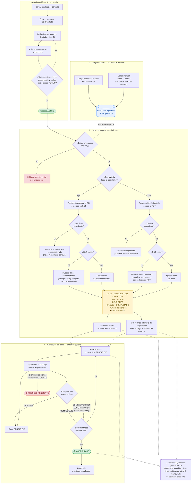
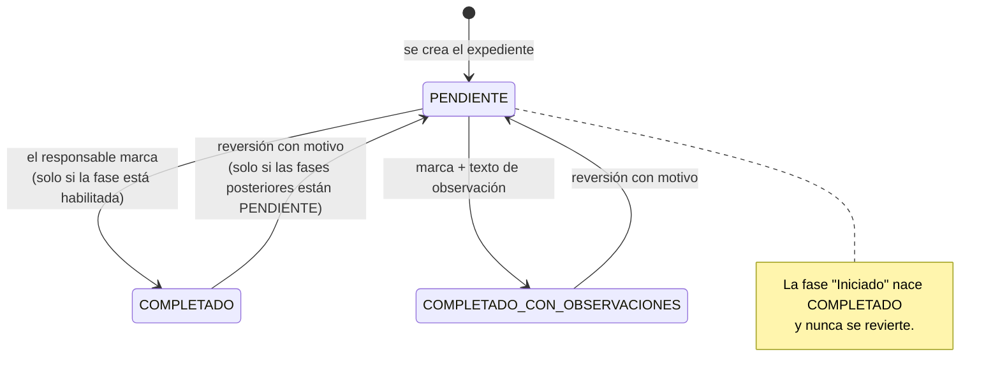

# SPEC — Sistema WorkFlow

> Versión: 0.7 · Fecha: 2026-10-15 · Estado: revisado, en desarrollo
>
> **Cambios v0.7 (revisión técnica previa al desarrollo):**
> - El número de atención es **correlativo por proceso**, sin reinicio diario, único por proceso, y guarda la fecha y hora de asignación para estadísticas (RF-19).
> - El mínimo de un responsable por fase se exige al activar el proceso y mientras esté ACTIVO, no durante la configuración en BORRADOR (RF-04).
> - Eliminar una fase que deja a un Usuario de fase sin fases se rechaza (§4).
> - Los postulantes sin expediente tienen su propia fecha de eliminación (`eliminar_en`) (RF-26).
> - `proceso_resumen` con clave propia y momento de generación definido. `expediente_fase` con `UNIQUE(expediente_id, fase_id)`.
> - Límite de reenvíos del enlace por expediente (RF-10, RF-21).
> - Cambios de estado con bloqueo de la fila del expediente (`SELECT … FOR UPDATE`), además del bloqueo optimista (RNF-06).
> - Bloqueo de login de 15 minutos. Flask-Limiter usa Redis, compartido por los workers (§7).
> - Se mantiene configurable `enmascarar_datos_qr` (decisión explícita del usuario).
> - Componentes de firmaDocs se implementan desde cero, siguiendo sus convenciones. Desarrollo local con Docker Desktop.
>
> **Cambios v0.6 (revisión final):**
> - Se agregan diagramas de flujo y de estados (§9.6).
> - Al cerrar un proceso, los expedientes sin todas las fases completas quedan como **"Proceso pendiente"**.
> - **Precondición obligatoria:** sin un proceso ACTIVO, configurado con sus fases y responsables, no se puede iniciar ningún recorrido, por ninguna vía.
> - **Conservación de datos:** los datos viven solo durante el período lectivo, **de enero a noviembre aproximadamente**, y luego se eliminan (RF-26).
> - Se corrige un criterio de aceptación que contradecía la corrección de datos por el staff.
> - Se retiran del documento las credenciales SMTP: viven solo en el `.env`.
>
> **Cambios v0.5:**
> - Un solo teléfono por postulante (columna `telefono_postulante`).
> - Las carreras se eligen de un **catálogo por código** que mantiene el Administrador (RF-25).
> - El responsable de "Iniciado" puede **corregir datos** durante el inicio (excepto el RUT), con auditoría.
> - Un solo proceso activo a la vez.
> - Se envía un correo al quedar **Matriculado**, desde una cuenta no-reply.
> - El Gestor consulta la auditoría de expedientes y postulantes en modo de solo lectura.
> - Volumen de referencia: 2.500 postulantes y 40 usuarios concurrentes.
> - Se confirman los límites de la carga masiva y la política de contraseñas.
>
> **Cambios v0.4:**
> - Se separan dos conceptos que no deben confundirse:
>   - **Carga de datos** (§5.2): registrar postulantes, manual o masivamente, **sin** iniciar su proceso.
>   - **Inicio de proceso** (§5.3): crear el expediente del postulante y completar la fase "Iniciado".
> - El proceso de un postulante se inicia **solo de dos formas**: por QR (autoinicio) o por el staff que lo recibe. Ambas están en fase 1.
> - Inician procesos los **responsables de la fase "Iniciado"**, como en cualquier otra fase.
> - El permiso `puede_registrar_postulantes` aplica **solo a la carga manual**.
> - En el QR, si el RUT existe, se despliegan sus datos para completar los pendientes, **enmascarados por defecto**. El enmascaramiento es configurable (sí/no).
>
> **Cambios v0.3:** correo personal obligatorio y envío del enlace de seguimiento · una sola sede · formato del archivo de precarga · bloqueo de la estructura de fases al iniciar el workflow.
> **Cambios v0.2:** orden secuencial obligatorio · "Completado con observaciones" cuenta como completado · usuarios propios (SSO Google después) · stack de firmaDocs.

---

## 1. Objetivo

Sistema web para **definir, configurar y mantener workflows** compuestos por fases ordenadas, y para **registrar el avance de cada postulante** a través de esas fases. Cada fase tiene usuarios responsables, que marcan su estado.

El caso de uso inicial es el **proceso de matrícula**. Aun así, el modelo debe ser genérico para poder reutilizarse en otros procesos, como admisión, titulación o beneficios. El sistema opera para **una sola sede**.

## 2. Alcance

### 2.1 Dentro del alcance

- Configuración de procesos (workflows) y de sus fases: identificador, descripción y orden.
- Asignación de usuarios responsables a cada fase.
- Catálogo de carreras.
- **Carga de datos de postulantes**: masiva desde CSV o Excel, y manual.
- **Inicio de proceso** por dos vías: autoinicio por QR, o inicio por el staff que recibe al postulante.
- Búsqueda de postulantes por RUT.
- Seguimiento del estado de cada fase por postulante, respetando el orden definido.
- Envío por correo al postulante del resumen del proceso y de su enlace único de seguimiento.
- Vista de seguimiento del postulante, a la que se accede con el enlace único.
- Tres roles con permisos diferenciados: Administrador, Gestor y Usuario de fase.
- Autenticación con usuarios propios del sistema (correo y contraseña).
- Auditoría completa de las acciones de los usuarios del sistema.
- Reportería para Gestor y Administrador.

### 2.2 Fuera del alcance (por ahora)

- **SSO con Google.** Se implementará en una etapa posterior, pero el modelo de usuarios queda preparado para ello (ver RF-22).
- Varias sedes o unidades (multi-tenant).
- Integración de pagos (la fase Finanzas solo registra el estado, no procesa pagos).
- Firma electrónica de contratos.
- Notificaciones por SMS o WhatsApp, y correos en cada cambio de fase (ver §12).
- Integración en línea con sistemas académicos externos. La carga de postulantes es por archivo (RF-08).

## 3. Glosario

| Término | Definición |
|---|---|
| **Proceso / Workflow** | Conjunto ordenado de fases que debe recorrer un postulante (ej.: "Matrícula 2027"). |
| **Proceso iniciado** | Proceso que ya tiene al menos un expediente creado. Su estructura de fases queda bloqueada (RF-05). |
| **Fase** | Etapa del proceso (ej.: Iniciado, Finanzas, Contrato, Becas). Tiene identificador, descripción, orden y responsables. |
| **Postulante** | Persona que recorre el proceso. Se identifica por su RUT. |
| **Carga de datos** | Registro de los datos de un postulante, manual o masivo. **No inicia su proceso** ni crea expediente. |
| **Inicio de proceso** | Acción que crea el expediente del postulante y completa la fase "Iniciado". Se hace **solo** por QR o por un responsable de la fase "Iniciado". |
| **Carreras de interés** | Hasta tres carreras del postulante, en orden de preferencia, elegidas del catálogo (RF-25). La primera es obligatoria. |
| **Expediente** | Instancia de un proceso para un postulante concreto. Contiene el estado de cada fase. |
| **Estado de fase** | Valor de una fase dentro de un expediente: `PENDIENTE`, `COMPLETADO` o `COMPLETADO_CON_OBSERVACIONES`. |
| **Proceso pendiente** | Estado final de un expediente que no completó todas sus fases cuando se cerró el proceso (RF-16). |
| **Fase habilitada** | Fase cuyas fases anteriores ya están completas, por lo que puede marcarse (RF-14). |
| **Fase actual** | Primera fase pendiente de un expediente. |
| **Enlace de seguimiento** | URL única y no adivinable con la que el postulante ve su workflow (RF-20). Se envía por correo y es la misma que se obtiene por QR. |
| **Número de atención** | Código correlativo que se entrega al postulante al iniciar el proceso (ej.: `M-0042`). |
| **Responsable** | Usuario del sistema asignado a una fase. Puede cambiar su estado. Los responsables de "Iniciado" son quienes inician procesos. |

## 4. Roles y permisos

| Acción | Administrador | Gestor | Usuario de fase |
|---|:-:|:-:|:-:|
| Gestionar usuarios y roles | ✅ | ❌ | ❌ |
| Habilitar o deshabilitar la carga manual a un Usuario de fase | ✅ | ❌ | ❌ |
| Crear, editar y ordenar procesos y fases (solo si el proceso no está iniciado) | ✅ | ❌ | ❌ |
| Configurar el enmascaramiento de datos del QR | ✅ | ❌ | ❌ |
| Asignar responsables a fases | ✅ | ❌ | ❌ |
| Mantener el catálogo de carreras | ✅ | ❌ | ❌ |
| **Carga de datos:** masiva (CSV/Excel) | ✅ | ✅ | ❌ |
| **Carga de datos:** manual | ✅ | ✅ | ⚙️ (*) |
| Editar datos ya registrados de postulantes (excepto RUT) | ✅ | ✅ | 🧩 (**) |
| **Inicio de proceso** (staff) | ✅ | ✅ | 🧩 (**) |
| Buscar postulante y ver todas sus fases y estados | ✅ | ✅ | ✅ |
| Reenviar el correo con el enlace de seguimiento | ✅ | ✅ | ✅ |
| Cambiar el estado de **cualquier** fase habilitada | ✅ | ✅ | ❌ |
| Cambiar el estado de **sus** fases habilitadas | ✅ | ✅ | ✅ |
| Acceder a reportería | ✅ | ✅ | ❌ |
| Consultar la auditoría | ✅ completa | 👁️ (***) | ❌ |

(\*) ⚙️ Solo si el Administrador le habilitó el permiso `puede_registrar_postulantes`. **Por defecto está deshabilitado.**
(\*\*) 🧩 Solo si es **responsable de la fase "Iniciado"** del proceso activo. Es coherente con la regla general de que cada usuario actúa sobre sus fases. La edición de datos la puede hacer solo **durante el inicio de proceso** (RF-09).
(\*\*\*) 👁️ Solo lectura, y solo la auditoría de expedientes y postulantes: inicios, cambios de estado, cargas, ediciones de datos y correos. No ve la auditoría de configuración, usuarios ni sesiones (RF-24).

**Regla:** todo usuario con rol *Usuario de fase* debe tener **al menos una fase asignada**. El sistema no permite guardar un usuario de fase sin fases, ni quitarle su última fase, ni eliminar una fase que sea la última de algún usuario (se informa qué usuarios deben reasignarse antes). La regla **no aplica** al Administrador ni al Gestor, que ya pueden actuar sobre todas las fases.

## 5. Requerimientos funcionales

### 5.1 Configuración de procesos y fases (Administrador)

**RF-01 — Gestión de procesos.** El Administrador puede crear, editar, activar y cerrar procesos (ej.: "Matrícula 2027").
- Atributos: `código`, `nombre`, `descripción`, `fecha_inicio`, `fecha_fin`, `prefijo_atencion`, `enmascarar_datos_qr` (sí/no, **por defecto sí**, ver RF-10) y `estado`.
- Estados del proceso:
  - **BORRADOR**: en configuración. No acepta inicios de proceso.
  - **ACTIVO**: acepta inicios de proceso.
  - **CERRADO**: no acepta inicios ni cambios de estado, y los enlaces de seguimiento expiran. Al cerrar, todos sus expedientes quedan cerrados (`cerrado_en`) y en modo de solo lectura, con el estado global que tenían en ese momento. Los que no completaron todas las fases quedan con estado **"Proceso pendiente"** (RF-16) y siguen disponibles en la reportería hasta la eliminación de los datos (RF-26). El cierre exige una confirmación que indica cuántos expedientes quedarán como "Proceso pendiente".
- Solo puede haber **un proceso ACTIVO a la vez**. El QR y el inicio por staff usan siempre ese proceso, sin que haya que elegirlo. Para activar un proceso, el que esté activo debe cerrarse antes.
- Para activar un proceso, todas sus fases, incluida "Iniciado", deben tener al menos un responsable.

**RF-02 — Gestión de fases.** Dentro de un proceso, el Administrador puede crear, editar, reordenar y eliminar fases, con las restricciones de RF-05.
- Atributos obligatorios: `identificador` (código único dentro del proceso, ej.: `FIN`), `nombre`, `descripción` y `orden` (entero, único dentro del proceso).
- El orden define la secuencia **obligatoria** en que se completan las fases (RF-14).

**RF-03 — Fase inicial "Iniciado".** Todo proceso tiene una fase inicial de sistema (orden 1), que no se puede eliminar ni reordenar.
- Como cualquier fase, tiene **responsables asignados**: son los usuarios del staff que reciben a los postulantes e inician su proceso (RF-09).
- Se marca `COMPLETADO` cuando se crea el expediente, por cualquiera de las dos vías de inicio (§5.3).
- No se puede revertir a `PENDIENTE`, porque su completitud equivale a la existencia del expediente.

**RF-04 — Asignación de responsables.** Cada fase tiene **uno o más** usuarios responsables, y un usuario puede ser responsable de **una o más** fases (relación N:M).
- Los responsables se pueden cambiar en cualquier momento, incluso con el proceso iniciado (por ejemplo, por reemplazo de personal).
- En BORRADOR, una fase puede quedar temporalmente sin responsables mientras se configura. Para activar el proceso, y mientras esté ACTIVO, cada fase debe tener al menos un responsable: no se puede quitar el último responsable de una fase ni desactivar a un usuario que sea el único responsable de una fase de un proceso ACTIVO.

**RF-05 — Bloqueo de la estructura del workflow.** Un proceso se considera **iniciado** desde que se crea su primer expediente.
- **Proceso no iniciado** (nuevo, o existente sin expedientes): se pueden agregar, eliminar y reordenar fases libremente.
- **Proceso iniciado:** **no se pueden** agregar, eliminar ni reordenar fases. Los controles correspondientes se ocultan en la interfaz, y el servidor rechaza el intento.
- En un proceso iniciado solo se pueden modificar textos que no alteran el flujo: nombre y descripción de las fases, y descripción del proceso. Estos cambios quedan auditados.
- Si se necesita otra estructura, se crea un proceso nuevo, idealmente clonando el existente (ver §12).

### 5.2 Carga de datos de postulantes

> Este módulo **solo registra o actualiza datos** de postulantes. **No inicia su proceso, no crea expedientes ni envía correos.** El inicio del proceso se describe en la §5.3.

**RF-06 — Datos del postulante.** Son los mismos en todas las vías: carga manual, carga masiva, inicio por staff e inicio por QR.

| Campo | Columna en archivo | Tipo | Obligatorio | Validación |
|---|---|---|:-:|---|
| RUT | `rut_postulante` | String | ✅ | Dígito verificador válido (módulo 11), único. Se acepta con o sin puntos y guion, y se normaliza a `12345678-9` |
| Nombres | `nombres_postulante` | String | ✅ | No vacío, máx. 100 caracteres |
| Apellidos | `apellidos_postulante` | String | ✅ | No vacío, máx. 100 caracteres |
| Teléfono | `telefono_postulante` | String | ✅ | Un solo número, de 8 a 15 dígitos, con `+` opcional. Se ignoran espacios y guiones |
| Correo personal | `correo_personal_postulante` | String | ✅ | Formato de correo válido |
| Carrera 1 | `carrera1_postulante` | String | ✅ | **Código** de una carrera activa del catálogo (RF-25) |
| Carrera 2 | `carrera2_postulante` | String | ❌ | Código de una carrera activa del catálogo |
| Carrera 3 | `carrera3_postulante` | String | ❌ | Código de una carrera activa del catálogo. Requiere Carrera 2 |

- Las carreras deben ser distintas entre sí.
- En los formularios (carga manual, inicio por staff y QR), las carreras se eligen de una **lista desplegable** del catálogo, que muestra el nombre y guarda el código. Solo en el archivo de carga masiva se escribe el código.
- El RUT no se puede editar una vez creado el postulante. Si hubo un error, el postulante se desactiva y se crea uno nuevo.

**RF-07 — Carga manual.** Registro de un postulante desde un formulario, sin iniciar su proceso. Sirve, por ejemplo, para dejar registrado a un postulante que llegó fuera de la precarga.
- **Quién:** Administrador y Gestor siempre. Usuario de fase solo con el permiso `puede_registrar_postulantes` (RF-23).
- **Edición** de postulantes ya registrados: Administrador y Gestor, en cualquier momento. Los responsables de "Iniciado" también pueden corregir datos, pero solo durante el inicio de proceso (RF-09).

**RF-08 — Carga masiva desde CSV o Excel.** El Administrador y el Gestor pueden precargar postulantes desde un archivo `.csv` o `.xlsx`, con las columnas de RF-06.

**Reglas del archivo:**
- La primera fila contiene los encabezados. Los nombres de columna **no distinguen mayúsculas de minúsculas** y se ignoran los espacios al inicio y al final.
- Los encabezados van **sin tildes**. Por compatibilidad, también se aceptan `telefonos_postulante` y `teléfonos_postulante` como alias de `telefono_postulante`.
- El orden de las columnas es libre. Si falta una columna obligatoria, el archivo se rechaza completo con un mensaje que indica cuál falta. Las columnas adicionales se ignoran.
- **CSV:** codificación UTF-8 (con o sin BOM). El separador `,` o `;` se detecta automáticamente, porque Excel en configuración regional chilena exporta con `;`.
- **Excel:** se lee solo la primera hoja. Todas las celdas se leen como texto, para no perder ceros ni dígitos verificadores `K`.
- Se puede descargar una **plantilla** (`.xlsx` y `.csv`) con estas columnas y una fila de ejemplo. La plantilla `.xlsx` incluye una segunda hoja, "Carreras", con el catálogo vigente (código y nombre) como referencia. Esa hoja no se importa.

**Proceso de carga:**
- **Validación previa:** antes de guardar, el sistema muestra una vista previa con tres grupos:
  - **Nuevos**: RUT válidos que no existen en la base.
  - **Existentes**: RUT ya registrados. Se muestran los datos que cambiarían.
  - **Con errores**: RUT inválido, campo obligatorio vacío, correo o teléfono mal formado, código de carrera inexistente o inactivo, o RUT duplicado dentro del archivo. Cada fila indica el número de fila y el motivo.
- Para los existentes, quien carga elige entre **no modificar** (opción por defecto), **completar solo los campos vacíos** o **sobrescribir**.
- Las filas con errores no se importan, pero no impiden importar las filas válidas.
- Al confirmar, la importación se ejecuta en una sola transacción. Al terminar se muestra un resumen (creados, actualizados, omitidos y con error) y se puede descargar el detalle de errores en CSV.
- Límites: hasta **10 MB y 20.000 filas** por archivo.

### 5.3 Inicio de proceso

> El proceso de un postulante se inicia **únicamente** por una de estas dos vías. Ambas terminan en la creación del expediente (RF-11). La carga de datos (§5.2) **nunca** inicia un proceso.
>
> **Precondición obligatoria para ambas vías:** debe existir un proceso en estado **ACTIVO**, es decir, configurado con sus fases, con responsables en todas ellas y activado por el Administrador (RF-01). Si no existe, **no se puede iniciar ningún recorrido por ninguna vía**: ni QR, ni staff, ni llamadas directas a la API. El servidor valida esta condición en cada intento, dentro de la misma transacción que crea el expediente.

**RF-09 — Inicio por staff.** Un usuario del staff recibe al postulante e inicia su proceso desde la pantalla *"Iniciar proceso"*.
- **Quién:** los responsables de la fase "Iniciado" del proceso activo, además del Administrador y el Gestor.
- Si no hay un proceso ACTIVO, la pantalla muestra *"No hay un proceso de matrícula activo"*, no muestra el formulario y no permite iniciar.

Flujo:
1. El usuario ingresa el RUT del postulante, y el sistema lo valida.
2. **Si el RUT existe** (por precarga, carga manual o un proceso anterior):
   - Se despliegan sus datos **completos**, porque es personal autenticado.
   - Los campos obligatorios vacíos deben completarse para continuar.
   - Como tiene al postulante enfrente, el usuario **puede corregir cualquier dato ya registrado, excepto el RUT** (por ejemplo, un teléfono que cambió o una carrera distinta). Cada corrección queda auditada con el valor anterior y el nuevo.
3. **Si el RUT no existe:** se despliega el formulario vacío con los campos de RF-06 y el RUT precargado. El usuario ingresa los datos que le entrega el postulante. Esto **es parte del inicio de proceso** y no requiere el permiso de carga manual.
4. **Si el postulante ya tiene expediente** en el proceso activo, no se crea otro. Se muestra el expediente existente, con la opción de reenviar el enlace.
5. Al confirmar, se crea el expediente (RF-11) y se muestra el número de atención para entregárselo al postulante.

**RF-10 — Inicio por QR (autoinicio).** Un QR "Inicia aquí" lleva a un formulario público (sin login) optimizado para móvil. Si no hay un proceso ACTIVO, **no se muestra el formulario**: solo el mensaje *"El proceso de matrícula no está abierto"*. Tampoco se aceptan envíos directos al formulario.

Flujo:
1. El postulante ingresa su RUT, y el sistema lo valida.
2. **Si el RUT existe:**
   - Se despliegan sus datos registrados, según la configuración `enmascarar_datos_qr` del proceso (RF-01):
     - **Sí (por defecto):** los datos se muestran **enmascarados**, de modo que el postulante los reconozca sin exponerlos completos. Formato:
       - Nombres y apellidos: primeras 2 letras de cada palabra (ej.: `Ju*** Pé***`).
       - Teléfono: últimos 4 dígitos (ej.: `+569 ****5678`).
       - Correo: primera letra y dominio (ej.: `j***@gmail.com`).
       - Carreras: se muestran completas.
     - **No:** los datos se muestran completos.
   - En ambos casos, los campos con datos son **de solo lectura**. El postulante solo ingresa los datos **pendientes**, es decir, los campos obligatorios vacíos o las carreras opcionales que falten.
   - Si sus datos están incorrectos, se le indica que los corrija con el staff.
3. **Si el RUT no existe:** el postulante completa el formulario con todos los campos de RF-06.
4. **Si el postulante ya tiene expediente** en el proceso activo, no se crea otro. Se le reenvía el enlace **a su correo registrado** y se le muestra el mensaje *"Te enviamos tu enlace a j\*\*\*@gmail.com"*. El enlace no se muestra en pantalla, para no exponer el expediente a quien solo conoce el RUT.
5. Al enviar, se crea el expediente (RF-11) y se redirige al postulante a su enlace de seguimiento (RF-20), que muestra su número de atención. **Es el mismo enlace que recibe por correo.**

Protección contra abuso:
- Límite de solicitudes por IP y CAPTCHA.
- Límite de reenvíos del enlace por expediente: como máximo 3 por hora, sumando el reenvío por QR y el manual. Superado el límite, el QR muestra el mismo mensaje sin enviar, para no revelar nada, y el intento queda auditado.
- Cada consulta de un RUT existente queda auditada (actor `PUBLICO`, con IP).

**RF-11 — Creación del expediente.** Ocurre al confirmar el inicio, por cualquiera de las dos vías, en el proceso ACTIVO. En una sola transacción:
- Se crea el postulante, si no existía, o se actualizan sus datos. En el QR solo se completan los pendientes; en el inicio por staff también se aplican las correcciones. Queda registrado el origen (`INICIO_STAFF` o `INICIO_QR`).
- Se generan registros para todas las fases del proceso, con estado `PENDIENTE`.
- La fase "Iniciado" queda `COMPLETADO`, registrando quién la completó: el usuario del staff, o `PUBLICO` en el caso del QR.
- Se asigna un número de atención (RF-19).
- Se genera el token del enlace de seguimiento (RF-20).

Después de confirmar la transacción, se envía el correo de inicio al postulante (RF-21).

Un postulante puede tener **un solo expediente por proceso**.

### 5.4 Gestión de estados de fase

**RF-12 — Estados posibles.** `PENDIENTE` (valor por defecto), `COMPLETADO` y `COMPLETADO_CON_OBSERVACIONES`.
- Si el responsable no marca la fase, el estado sigue siendo `PENDIENTE`.

**RF-13 — Cambio de estado.** El responsable de una fase, o un Gestor o Administrador, puede cambiar su estado para un postulante, siempre que la fase esté **habilitada** (RF-14).
- `COMPLETADO_CON_OBSERVACIONES` exige ingresar un texto de observación.
- Se registran quién hizo el cambio, cuándo y el valor anterior.
- Se permite volver a `PENDIENTE` (por ejemplo, para corregir un error), con estas condiciones:
  - La acción exige un motivo y queda auditada.
  - Solo se permite si **todas las fases posteriores están `PENDIENTE`**. Para revertir una fase intermedia, primero hay que revertir las posteriores, de la última hacia atrás.
  - La fase "Iniciado" nunca se revierte (RF-03).

**RF-14 — Orden secuencial obligatorio.** Las fases se completan **estrictamente en el orden definido**, y la regla aplica a todos los roles.
- Una fase está **habilitada** solo si todas las fases de menor orden están `COMPLETADO` o `COMPLETADO_CON_OBSERVACIONES`.
- En una fase no habilitada, los controles de cambio de estado aparecen deshabilitados, con el mensaje *"Requiere completar: «nombre de la fase anterior pendiente»"*.
- El servidor valida la regla: un intento de cambiar el estado de una fase no habilitada se rechaza aunque se haga directamente por API.

**RF-15 — Consulta y visibilidad.** Cualquier usuario autenticado puede buscar un postulante por RUT y ver su ficha, con los datos y **todas** las fases en orden. Para cada fase se muestran su estado, fecha, responsable y observaciones.
- Se destaca visualmente la **fase actual**.
- Los controles de cambio de estado solo están habilitados en las fases que el usuario puede modificar según su rol (§4) y que además están habilitadas (RF-14).

**RF-16 — Estado global del expediente.**
- **Matriculado**: todas las fases están `COMPLETADO` o `COMPLETADO_CON_OBSERVACIONES`.
- **No matriculado aún**: al menos una fase está `PENDIENTE` y el proceso sigue ACTIVO.
- **Proceso pendiente**: al menos una fase quedó `PENDIENTE` cuando el proceso se cerró. Es un estado final: el expediente queda en solo lectura.
- El estado global es calculado y no se edita a mano.

### 5.5 Bandeja de trabajo

**RF-17 — Bandeja por fase.** Cada Usuario de fase ve la lista de postulantes cuya **fase actual** es una de las fases que tiene asignadas, es decir, los que están esperando ser atendidos por él.
- La lista se ordena por número de atención.
- Se puede filtrar por fecha y por carrera, y ver también los postulantes que aún vienen en fases anteriores.
- Desde la bandeja se accede directamente al expediente.
- Los responsables de "Iniciado" tienen además acceso directo a la pantalla *"Iniciar proceso"* (RF-09).

### 5.6 Reportería (Gestor y Administrador)

**RF-18 — Reportes.**
- Lista de expedientes con su estado global y su fase actual, con filtros por proceso, fecha, fase, estado y carrera.
- Avance por fase: cantidad de expedientes detenidos en cada fase (embudo).
- Matriculados y pendientes por carrera de primera preferencia.
- Inicios de proceso por vía (QR o staff) y por día.
- Tiempo promedio por fase y tiempo total del proceso.
- Productividad por responsable: cantidad de cambios de estado e inicios de proceso por usuario y periodo.
- Postulantes cargados que aún no inician el proceso.
- Al cierre: cantidad de expedientes Matriculados y en "Proceso pendiente", con la fase en que quedó detenido cada uno.
- Fecha programada de eliminación de los datos del proceso (RF-26).
- Correos de seguimiento con envío fallido (RF-21).
- Exportación a CSV/Excel.

### 5.7 Seguimiento del postulante y correo

**RF-19 — Número de atención.** Correlativo **por proceso**, sin reinicio diario, con el prefijo configurado en el proceso (ej.: `M-0001`, `M-0002`, …). Es único dentro del proceso (`UNIQUE(proceso_id, numero_atencion)`) y se asigna dentro de la transacción de creación del expediente, bloqueando el contador del proceso para evitar duplicados. Internamente se guarda la fecha y hora de asignación (`expediente.creado_en`), que se usa en estadísticas y reportes (inicios por día, por hora, etc.). Se muestra al usuario del staff, en la vista de seguimiento y en el correo.

**RF-20 — Vista de seguimiento del postulante (enlace único).** Se accede mediante una URL personal con un token aleatorio de al menos 128 bits, no adivinable (ej.: `/seguimiento/{token}`). Es la misma URL que llega por correo y a la que redirige el QR. La vista muestra:
- El número de atención, en tamaño destacado, y el primer nombre del postulante. No muestra el RUT ni otros datos personales.
- Las carreras de interés.
- El workflow completo en orden, con cada fase marcada como completada o por completar, y la fase actual destacada. No muestra las observaciones internas ni los nombres de los responsables.
- Un mensaje persistente (fijo en pantalla):
  - 🔴 **"No matriculado aún"**, en rojo, si alguna fase está pendiente.
  - 🟢 **"Matriculado"**, en verde, si todas las fases están completas.

Comportamiento:
- La vista se actualiza automáticamente, por ejemplo cada 30 segundos, sin recargar a mano.
- El token expira cuando el proceso pasa a CERRADO. Desde entonces, la vista muestra *"Este proceso ha finalizado"*.

**RF-21 — Correo al postulante.** Se envía al `correo_personal` del postulante.

**Cuándo se envía:**
- **Correo de inicio:** automáticamente al crear el expediente (RF-11), por cualquiera de las dos vías.
- **Correo de matrícula completada:** automáticamente cuando el expediente pasa a **Matriculado** (RF-16), es decir, al completarse la última fase. Incluye el resumen final con todas las fases completadas y el enlace de seguimiento. Si después se revierte una fase y se vuelve a completar, el correo **no** se reenvía automáticamente; se puede reenviar a mano.
- **Reenvío manual:** desde la ficha del postulante, cualquier rol puede reenviarlo con el botón *"Reenviar enlace"*.
- **Reenvío por QR:** cuando el postulante ya tiene expediente (RF-10, paso 4).

**Contenido:**
- Nombre del proceso y número de atención.
- Resumen del workflow: la lista de fases en orden y su estado en ese momento.
- Carreras de interés registradas.
- El **enlace único de seguimiento** (RF-20), destacado como botón y también como texto.
- Un aviso de que el enlace es personal y no debe compartirse.

**Envío:**
- Se reutiliza el servicio SMTP de firmaDocs (`app/services/email.py`), con plantilla HTML y versión en texto plano.
- **Remitente:** la cuenta institucional **`matricula-noreply@unach.cl`**, exclusiva para estos envíos y configurada en `SMTP_FROM_EMAIL` del `.env`. El correo indica que no se debe responder e incluye un medio de contacto de la unidad de matrícula.
- El correo se envía **después** de confirmar la transacción del expediente o del cambio de estado. Si el envío falla, el expediente se crea igual.
- Cada envío queda registrado con su estado (`ENVIADO` o `ERROR`) y el detalle del error. La ficha del postulante y la reportería muestran los envíos fallidos para reintentarlos.
- Si el postulante no recibe el correo y su dirección estaba mal, un Administrador o Gestor corrige el correo y reenvía el enlace.

### 5.8 Autenticación y usuarios

**RF-22 — Autenticación con usuarios propios.** El inicio de sesión se hace con correo y contraseña.
- Las cuentas las crea el Administrador, con una contraseña temporal. En el primer ingreso, el sistema obliga a cambiarla (`must_change_password`).
- Las contraseñas se guardan con hash bcrypt.
- Política de contraseña: mínimo 10 caracteres.
- Bloqueo temporal de 15 minutos tras 5 intentos fallidos consecutivos.
- La sesión expira tras 8 horas, o tras 30 minutos de inactividad.
- El Administrador puede restablecer la contraseña de un usuario, lo que genera una nueva contraseña temporal.
- El primer Administrador se crea desde variables de entorno al iniciar la aplicación, igual que el super admin de firmaDocs.
- **Preparación para SSO:** el usuario se identifica por su correo, `password_hash` admite nulo y existe el campo `google_sub` (nulo por ahora). Así, más adelante se podrá agregar el login con Google sin migrar las cuentas.

**RF-23 — Gestión de usuarios.** El Administrador crea, edita y desactiva usuarios y les asigna un rol. Si el rol es Usuario de fase:
- Le asigna fases (mínimo una, ver §4). Asignarlo a la fase "Iniciado" lo habilita para iniciar procesos (RF-09).
- Define el permiso `puede_registrar_postulantes` (sí/no), que habilita **solo la carga manual** (RF-07). **Por defecto es "no".** Cada cambio de este permiso queda auditado.

Los usuarios no se eliminan, solo se desactivan, para conservar la auditoría.

### 5.9 Auditoría

**RF-24 — Registro de auditoría.** Se registran **todas** las acciones de los tres roles:
- Inicio de sesión (exitoso y fallido), cierre de sesión y cambio de contraseña.
- Carga manual, cargas masivas (archivo, totales y usuario) y edición de postulantes.
- Inicios de proceso, indicando la vía (staff o QR).
- Cambios de estado y reversiones.
- Envíos y reenvíos de correo.
- Cambios de configuración de procesos, fases, responsables y enmascaramiento.
- Gestión de usuarios y cambios de permisos.
- Exportación de reportes.

Actores especiales:
- `PUBLICO`: las acciones del postulante en el formulario QR, incluidas las consultas de RUT existentes.
- `SISTEMA`: los envíos automáticos de correo.

Características:
- Cada registro guarda: `fecha_hora`, `usuario`, `rol`, `acción`, `entidad`, `id_entidad`, `valor_anterior`, `valor_nuevo` (JSON), `ip` y `user_agent`.
- La auditoría es de **solo inserción**: ningún rol puede editar ni eliminar registros.
- Se puede consultar con filtros por usuario, acción, entidad y rango de fechas.

Quién la consulta:
- **Administrador:** toda la auditoría.
- **Gestor:** solo lectura, y solo los registros de expedientes y postulantes: inicios de proceso, cambios de estado, reversiones, cargas, ediciones de datos y correos. No ve los registros de configuración, usuarios, permisos ni sesiones.

### 5.10 Catálogo de carreras

**RF-25 — Catálogo de carreras.** El Administrador mantiene el catálogo de carreras que se usa en todas las vías de registro.
- Atributos: `código` (único, ej.: `ENF`), `nombre` (ej.: "Enfermería") y `activo`.
- Las carreras usadas por algún postulante no se eliminan, solo se desactivan. Una carrera inactiva no aparece en las listas desplegables y se rechaza en la carga masiva, pero se sigue mostrando en los postulantes que ya la tienen.
- El catálogo se puede cargar inicialmente desde un CSV o Excel con las columnas `codigo_carrera` y `nombre_carrera`.
- Los cambios en el catálogo quedan auditados.

### 5.11 Conservación y eliminación de datos

**RF-26 — Conservación limitada al período lectivo.** Los datos personales asociados a un proceso se conservan **solo durante el período lectivo, de enero a noviembre aproximadamente**.
- **Fecha de eliminación:** cada proceso tiene una `fecha_eliminacion`, que el Administrador define al crearlo. Por defecto es el **30 de noviembre del año de `fecha_inicio`** (ej.: un proceso "Matrícula 2027" que empieza en enero de 2027 se elimina el 30-11-2027). La fecha se puede ajustar, porque el fin del período lectivo es aproximado.
- **Reglas:**
  - La `fecha_eliminacion` debe ser posterior a la `fecha_fin` del proceso.
  - Solo se eliminan los datos de procesos **CERRADOS**. Si al llegar la fecha el proceso sigue ACTIVO, no se elimina nada y el Administrador recibe una alerta para cerrarlo o ajustar la fecha.
- **Qué se elimina al vencer el plazo:**
  - Los expedientes del proceso, con sus estados de fase y observaciones.
  - Los registros de envío de correo.
  - Los datos personales de los postulantes (RUT, nombres, apellidos, teléfono, correo y carreras), salvo que el postulante tenga un expediente en un proceso más reciente.
  - Los postulantes cargados que nunca iniciaron un proceso, según su propia fecha `eliminar_en`. Se fija al registrarlos: es la `fecha_eliminacion` del proceso ACTIVO en ese momento o, si no hay uno, el 30 de noviembre del año de la carga. Cuando el postulante inicia un proceso, `eliminar_en` se vacía y pasa a regir la fecha de ese proceso.
- **Auditoría:** los registros no se borran, pero se **anonimizan**. Se eliminan el RUT, los nombres, el correo y el teléfono de los campos `valor_anterior` y `valor_nuevo`, y se conservan la acción, la fecha, el usuario del staff y la entidad. Es la única excepción a la regla de "solo inserción", y solo la ejecuta el proceso automático de eliminación.
- **Lo que no se elimina:** la configuración del proceso y sus fases, los usuarios del staff, el catálogo de carreras y los **totales agregados** del proceso (cantidad de matriculados y de procesos pendientes, por carrera y por fase), para conservar estadísticas sin datos personales.
- Los totales agregados (`proceso_resumen`) se calculan **al cerrar el proceso** y se recalculan justo antes de la eliminación, dentro de la misma transacción.
- **Ejecución:** un comando programado (`flask purgar-datos`) se ejecuta diariamente con cron en el servidor, fuera de Gunicorn. Cada ejecución queda auditada con el actor `SISTEMA` y la cantidad de registros eliminados.
- **Aviso previo:** 30 días antes de la fecha de eliminación, el panel del Administrador y del Gestor muestra un aviso, para que puedan exportar los reportes que necesiten.
- La eliminación es **irreversible**, y los respaldos de la base de datos deben rotar dentro del mismo plazo.

## 6. Requerimientos no funcionales

| ID | Requerimiento |
|---|---|
| RNF-01 | **Seguridad:** HTTPS obligatorio (Caddy), contraseñas con bcrypt, protección CSRF en todos los formularios (Flask-WTF) y control de acceso validado en el servidor, no solo en la interfaz. Los tokens de seguimiento se generan con `secrets.token_urlsafe`. |
| RNF-02 | **Protección de datos:** cumplimiento de la Ley 19.628 y de la Ley 21.719 de protección de datos personales. Se recolectan solo los datos mínimos y se informa la finalidad en el formulario QR y en el correo. El formulario QR enmascara los datos existentes por defecto. La vista de seguimiento no expone RUT, teléfono ni correo. Los archivos de carga masiva no se conservan tras procesarse; se guardan solo el resumen y la auditoría. Los datos personales se conservan solo durante el período lectivo (enero a noviembre, aproximadamente) y luego se eliminan o anonimizan (RF-26). |
| RNF-03 | **Usabilidad:** interfaz en español. El formulario QR, la vista de seguimiento y el correo son *mobile-first*. El inicio de proceso por staff, con un RUT precargado, se completa en menos de 1 minuto. El cambio de estado se hace en 3 clics o menos. |
| RNF-04 | **Rendimiento y volumen:** volumen de referencia en el peak de matrícula: **2.500 postulantes por proceso y 40 usuarios del staff concurrentes**, más el tráfico del QR y de las vistas de seguimiento. Se dimensiona con un margen de 2× (5.000 postulantes y 80 usuarios). La búsqueda por RUT, el inicio de proceso y el cambio de estado responden en menos de 1 s. Una carga masiva de 20.000 filas se procesa en menos de 60 s. El envío de correo no bloquea la respuesta al usuario más de 3 s. |
| RNF-05 | **Disponibilidad:** alta disponibilidad durante el periodo de matrícula y respaldo diario de la base de datos. |
| RNF-06 | **Concurrencia:** si dos usuarios modifican la misma fase al mismo tiempo, se usa bloqueo optimista (campo `version`) y el segundo recibe un aviso. Como las reglas de orden y reversión involucran varias fases, cada cambio de estado bloquea además la fila del expediente (`SELECT … FOR UPDATE`) durante la transacción. Dos inicios simultáneos del mismo RUT (por ejemplo, QR y staff a la vez) producen un solo expediente, gracias a la restricción `UNIQUE(proceso_id, postulante_id)`. La validación del orden (RF-14) y la del bloqueo de estructura (RF-05) se hacen dentro de la misma transacción. |
| RNF-07 | **Accesibilidad:** el estado no se comunica solo con color: los mensajes rojo y verde incluyen texto e ícono (WCAG 2.1 AA). |
| RNF-08 | **Calidad:** desarrollo guiado por pruebas (TDD) con pytest. Las reglas de negocio (permisos, orden secuencial, bloqueo de estructura, estado global, enmascaramiento y validación de la carga) tienen cobertura de pruebas. |

## 7. Stack tecnológico (igual a firmaDocs)

Se reutiliza el stack y las convenciones del proyecto `firmaDocs`. Como su repositorio no está disponible en la máquina de desarrollo actual, `email.py`, `migrate.py`, `docker-compose.yml` y `deploy.sh` se implementan desde cero siguiendo esas convenciones. El desarrollo local usa Docker Desktop (WSL2), con la misma imagen Python 3.12 que producción.

| Capa | Tecnología |
|---|---|
| Lenguaje | Python 3.12 |
| Framework web | Flask 3, con patrón *app factory* (`create_app()`) y Blueprints |
| ORM y base de datos | Peewee + PostgreSQL 16 (`psycopg2-binary`) |
| Migraciones | Scripts SQL numerados en `migrations/`, ejecutados por `migrate.py` |
| Frontend | Plantillas Jinja2 + Tailwind CSS. JS mínimo para el polling de la vista de seguimiento |
| Correo | SMTP con TLS desde una cuenta no-reply, reutilizando el patrón de `app/services/email.py` (plantillas HTML y de texto) |
| Seguridad | `bcrypt` (contraseñas), `flask-wtf` (CSRF), `secrets` (tokens de seguimiento) |
| QR | `qrcode[pil]` |
| Configuración | Variables de entorno con `python-dotenv` (`.env` / `.env.example`) |
| Servidor | Gunicorn con 3 workers. Es posible porque, a diferencia de firmaDocs, no hay jobs de APScheduler que obliguen a usar un solo worker. Es suficiente para 40 usuarios concurrentes |
| Despliegue | Docker Compose (`db` + `redis` + `web` + `caddy`), Caddy como proxy con TLS automático, y `deploy.sh` |
| Pruebas | `pytest` + `pytest-cov` (TDD) |
| Especificación | OpenSpec (escenarios Given/When/Then, palabras clave RFC 2119) |

**Dependencias nuevas respecto de firmaDocs:**
- `openpyxl`: lectura de `.xlsx` para la carga masiva, plantilla descargable y exportación de reportes. Para los `.csv` basta con el módulo `csv` de la biblioteca estándar.
- `Flask-Limiter`: límite de solicitudes del formulario QR público y del login. Usa **Redis** como almacenamiento (servicio `redis` en Docker Compose), para que el límite sea compartido por los 3 workers de Gunicorn.
- `redis`: cliente de Python para Flask-Limiter.

**Dependencias de firmaDocs que no se necesitan:**
- `pypdf` y `reportlab`.
- `Tenant`: se trabaja en una sola sede.
- `apscheduler`: las tareas periódicas, como la eliminación de datos (RF-26), se ejecutan como comandos CLI de Flask (`flask purgar-datos`) invocados por cron. Así no se duplican entre los workers de Gunicorn.

**Blueprints propuestos:**
- `auth`.
- `admin`: usuarios, procesos, fases, responsables y catálogo de carreras.
- `carga`: carga manual y masiva.
- `inicio`: inicio de proceso por staff.
- `expedientes`: búsqueda, ficha, cambio de estado y reenvío de correo.
- `bandeja`, `reportes` y `auditoria`.
- `publico`: formulario QR y vista de seguimiento.

**Servicios propuestos (`app/services/`):**
- `rut.py`: validación y normalización.
- `postulantes.py`: validación de datos (RF-06) y enmascaramiento, compartidos por la carga y el inicio.
- `inicio.py`: creación del expediente, común a las vías QR y staff.
- `workflow.py`: reglas de habilitación, bloqueo de estructura, cambio de estado y estado global.
- `importacion.py`: lectura y carga masiva.
- `email.py`: correo de inicio, correo de matrícula completada y reenvíos.
- `retencion.py`: cálculo de plazos, eliminación de datos y anonimización (RF-26).
- `auditoria.py` y `security.py`.

## 8. Modelo de datos (propuesta)

```
usuario (id, email UNIQUE, nombre, rol[ADMIN|GESTOR|USUARIO_FASE], password_hash NULL,
         must_change_password, puede_registrar_postulantes DEFAULT false,
         google_sub NULL UNIQUE, intentos_fallidos, bloqueado_hasta NULL, activo, creado_en)
proceso (id, codigo UNIQUE, nombre, descripcion, fecha_inicio, fecha_fin, prefijo_atencion,
         enmascarar_datos_qr DEFAULT true, estado[BORRADOR|ACTIVO|CERRADO],
         ultimo_numero_atencion DEFAULT 0,                    -- contador; se bloquea al asignar (RF-19)
         fecha_cierre NULL, fecha_eliminacion DEFAULT 30-11 del año de fecha_inicio, datos_eliminados_en NULL)
         -- "iniciado" se deriva: EXISTS(expediente WHERE proceso_id = id)
fase (id, proceso_id, identificador, nombre, descripcion, orden, es_sistema)
      UNIQUE(proceso_id, identificador), UNIQUE(proceso_id, orden)
fase_responsable (fase_id, usuario_id)                       -- N:M; incluye la fase "Iniciado"
carrera (id, codigo UNIQUE, nombre, activo)
postulante (id, rut UNIQUE, nombres, apellidos, telefono, correo_personal,
            origen[CARGA_MASIVA|CARGA_MANUAL|INICIO_STAFF|INICIO_QR], carga_id NULL,
            activo, eliminar_en NULL, creado_en, actualizado_en)  -- eliminar_en: solo sin expediente (RF-26)
postulante_carrera (postulante_id, preferencia[1|2|3], carrera_id)
            PK(postulante_id, preferencia), UNIQUE(postulante_id, carrera_id)
carga_masiva (id, usuario_id, nombre_archivo, politica_existentes[NO_MODIFICAR|COMPLETAR|SOBRESCRIBIR],
              total_filas, creados, actualizados, omitidos, con_error, creado_en)
expediente (id, proceso_id, postulante_id, via_inicio[STAFF|QR], iniciado_por NULL,
            numero_atencion, token_seguimiento UNIQUE, creado_en, cerrado_en,
            estado_final[MATRICULADO|PROCESO_PENDIENTE] NULL)            -- se fija al cerrar el proceso
            UNIQUE(proceso_id, postulante_id), UNIQUE(proceso_id, numero_atencion)
expediente_fase (id, expediente_id, fase_id, estado[PENDIENTE|COMPLETADO|COMPLETADO_CON_OBSERVACIONES],
                 observacion, actualizado_por NULL, actualizado_en, version)
                 UNIQUE(expediente_id, fase_id)
envio_correo (id, expediente_id, tipo[INICIO|MATRICULADO|REENVIO|REENVIO_QR], destinatario, estado[ENVIADO|ERROR],
              detalle_error NULL, enviado_por NULL, creado_en)
proceso_resumen (id, proceso_id, dimension[TOTAL|CARRERA|FASE], carrera_id NULL, fase_id NULL,
                 matriculados, proceso_pendiente, calculado_en)
            -- totales agregados sin datos personales; sobreviven a la eliminación (RF-26)
            -- TOTAL: ambos NULL · CARRERA: carrera_id (1ª preferencia) · FASE: fase_id (fase en que quedó detenido)
auditoria (id, fecha_hora, usuario_id NULL, actor[USUARIO|PUBLICO|SISTEMA], accion, entidad, entidad_id,
           valor_anterior JSONB, valor_nuevo JSONB, ip, user_agent)
```

## 9. Flujos principales

### 9.1 Configuración

1. El Administrador carga o actualiza el catálogo de carreras.
2. Crea el proceso en estado BORRADOR, define sus fases y orden, y asigna responsables, incluidos los de "Iniciado".
3. Define si el QR enmascara los datos (por defecto, sí).
4. Cierra el proceso anterior, si sigue activo, y activa el nuevo.
5. Mientras no tenga expedientes, aún puede ajustar las fases. Desde el primer expediente, la estructura queda bloqueada.
6. Al terminar el periodo de matrícula, cierra el proceso. Los expedientes incompletos quedan como "Proceso pendiente" y los datos se eliminan en la `fecha_eliminacion` (por defecto, el 30 de noviembre).

### 9.2 Carga de datos (no inicia procesos)

1. **Masiva:** el Administrador o el Gestor descarga la plantilla, la completa, la sube, revisa la vista previa, elige la política para los existentes y confirma.
2. **Manual:** un usuario con permiso registra a un postulante desde el formulario.
3. En ambos casos, el postulante queda registrado **sin expediente**, a la espera de iniciar su proceso.

### 9.3 Inicio de proceso por staff

1. El postulante llega y un responsable de "Iniciado" ingresa su RUT.
2. Si el RUT existe, ve sus datos completos, completa los pendientes y corrige lo que haya cambiado. Si no existe, ingresa todos los datos.
3. Al confirmar, se crea el expediente, la fase "Iniciado" queda `COMPLETADO` y se entrega el número de atención.
4. El postulante recibe el correo con el resumen y su enlace de seguimiento.

### 9.4 Inicio de proceso por QR

1. El postulante escanea el QR e ingresa su RUT.
2. Si el RUT existe, ve sus datos (enmascarados, si así está configurado) y completa solo los pendientes. Si no existe, completa todo el formulario.
3. Al enviar, se crea el expediente, el postulante es redirigido a su enlace de seguimiento con su número de atención y recibe el mismo enlace por correo.
4. Si ya tenía expediente, se le reenvía el enlace a su correo registrado.

### 9.5 Avance por las fases

1. El postulante avanza **en orden** por cada fase. Cada responsable lo ve en su bandeja cuando su fase pasa a ser la fase actual, y marca el estado.
2. El postulante sigue su avance desde el enlace. La vista se actualiza sola.
3. Cuando todas las fases están completas, el estado global pasa a **Matriculado** y el postulante recibe el correo de matrícula completada.

### 9.6 Diagramas

Los diagramas están en formato [Mermaid](https://mermaid.js.org). Se ven directamente en GitHub, GitLab y VS Code (con la extensión *Markdown Preview Mermaid Support*), o pegándolos en [mermaid.live](https://mermaid.live). También hay una versión en imagen de cada diagrama en `docs/diagramas/`: `flujo-completo.png`, `estados-fase.png` y `estados-proceso.png`.

#### 9.6.1 Flujo de trabajo completo



> Todas las acciones del diagrama quedan registradas en la auditoría (RF-24). Las acciones del QR se registran con el actor `PUBLICO`, y los correos automáticos con el actor `SISTEMA`.

#### 9.6.2 Estados de una fase dentro de un expediente



#### 9.6.3 Estados de un proceso


## 10. Pantallas

1. Inicio de sesión / cambio de contraseña obligatorio
2. **Iniciar proceso** (staff): ingreso de RUT, datos con campos pendientes editables y confirmación con número de atención
3. Búsqueda por RUT / ficha del postulante con su expediente, historial de correos y botón "Reenviar enlace"
4. **Carga manual** de postulante
5. **Carga masiva**: descarga de plantilla, subida, vista previa y resumen (Administrador y Gestor)
6. Edición de postulante (Administrador y Gestor)
7. Bandeja de trabajo por fase
8. Configuración de procesos y fases (Administrador). Indica si el proceso está iniciado y la estructura bloqueada, e incluye la opción de enmascarar datos del QR
9. Asignación de responsables (Administrador)
10. Gestión de usuarios y permiso de carga manual (Administrador)
11. Reportería (Gestor y Administrador)
12. Auditoría (Administrador completa; Gestor solo lectura y filtrada)
13. Catálogo de carreras (Administrador)
14. **Formulario QR** público (móvil), con modo enmascarado
15. Vista de seguimiento del postulante (pública con token, móvil)
16. Plantillas de correo de inicio y de matrícula completada (HTML y texto), y póster imprimible del QR "Inicia aquí"

## 11. Criterios de aceptación clave

**Permisos**
- [ ] Un usuario de fase no puede cambiar, ni desde la interfaz ni por API, el estado de una fase que no tiene asignada (respuesta 403).
- [ ] No se puede guardar un usuario de fase sin fases asignadas.
- [ ] Un Usuario de fase que no es responsable de "Iniciado" no puede iniciar procesos, ni por la interfaz ni por API (respuesta 403).
- [ ] Un Usuario de fase responsable de "Iniciado" puede iniciar el proceso de un RUT inexistente, aunque no tenga `puede_registrar_postulantes`.
- [ ] Un Usuario de fase recién creado tiene `puede_registrar_postulantes = false` y no puede usar la carga manual (respuesta 403).
- [ ] Con el permiso habilitado, el Usuario de fase puede usar la carga manual, pero no editar postulantes fuera del inicio de proceso ni usar la carga masiva.
- [ ] Un responsable de "Iniciado" puede corregir datos de un postulante existente durante el inicio, excepto el RUT, y cada cambio queda auditado con el valor anterior y el nuevo.
- [ ] El Gestor ve la auditoría de expedientes y postulantes, pero no la de configuración, usuarios ni sesiones, y no puede modificar nada.
- [ ] No se puede activar un proceso mientras haya otro ACTIVO.

**Carga de datos vs. inicio de proceso**
- [ ] La carga manual y la masiva **nunca** crean expedientes ni envían correos.
- [ ] Un expediente solo se crea por inicio de staff o por QR, y queda registrada la vía.

**Inicio de proceso**
- [ ] En el inicio por QR, los campos con datos existentes son de solo lectura. En el inicio por staff se pueden corregir, excepto el RUT. En ambas vías, los campos obligatorios vacíos deben completarse para continuar.
- [ ] Sin un proceso ACTIVO, ninguna vía permite iniciar un recorrido: el QR no muestra el formulario, la pantalla de inicio por staff no lo muestra, y un envío directo a la API es rechazado.
- [ ] Con `enmascarar_datos_qr = sí`, el formulario QR muestra los datos existentes enmascarados según el formato de RF-10, y la respuesta HTTP no contiene los datos completos.
- [ ] Con `enmascarar_datos_qr = no`, el formulario QR muestra los datos completos.
- [ ] Si el RUT ya tiene expediente, el QR no crea otro, no muestra el enlace en pantalla y lo reenvía al correo registrado.
- [ ] Dos inicios simultáneos del mismo RUT producen un único expediente.

**Workflow**
- [ ] Ningún rol puede marcar una fase si alguna fase anterior está `PENDIENTE` (respuesta 409 con el nombre de la fase bloqueante).
- [ ] No se puede revertir a `PENDIENTE` una fase si alguna fase posterior está completa, ni revertir nunca la fase "Iniciado".
- [ ] En un proceso con al menos un expediente, agregar, eliminar o reordenar fases es rechazado (respuesta 409), aunque se intente por API.
- [ ] En un proceso sin expedientes, se pueden agregar, eliminar y reordenar fases.
- [ ] Toda fase de un expediente nuevo nace como `PENDIENTE`, salvo "Iniciado".
- [ ] `COMPLETADO_CON_OBSERVACIONES` sin texto de observación es rechazado.
- [ ] El estado global es "Matriculado" solo si todas las fases están `COMPLETADO` o `COMPLETADO_CON_OBSERVACIONES`.

**Datos y carga masiva**
- [ ] Un RUT con dígito verificador inválido es rechazado en todas las vías.
- [ ] Un postulante sin correo personal o sin Carrera 1 no se puede registrar, por ninguna vía.
- [ ] Un código de carrera inexistente o inactivo se rechaza en la carga masiva, con el número de fila.
- [ ] Una carrera inactiva no aparece en las listas desplegables, pero se sigue mostrando en los postulantes que ya la tienen.
- [ ] Un archivo con la columna `telefonos_postulante` (alias antiguo) se importa igual que con `telefono_postulante`.
- [ ] Un archivo sin alguna columna obligatoria se rechaza completo, indicando la columna faltante.
- [ ] Un CSV separado por `;` y uno separado por `,` se importan igual.
- [ ] Un RUT con `K` y un RUT con ceros a la izquierda en Excel se leen correctamente.
- [ ] Una carga masiva con filas inválidas importa las filas válidas e informa cada error con su número de fila y motivo.
- [ ] Con la política "no modificar", una carga masiva no altera los datos de postulantes existentes.

**Correo y seguimiento**
- [ ] Al crear un expediente, por cualquier vía, se envía un correo al `correo_personal` con el resumen y el enlace de seguimiento, y el envío queda registrado.
- [ ] Al completarse la última fase, se envía una única vez el correo de matrícula completada.
- [ ] Los correos salen desde la cuenta configurada en `SMTP_FROM_EMAIL` (no-reply).
- [ ] Si el SMTP falla, el expediente se crea igual y el envío queda con estado `ERROR`, visible en la ficha.
- [ ] El enlace del correo y el de la redirección del QR son el mismo para un mismo expediente.
- [ ] La vista de seguimiento no muestra RUT, teléfono, correo, observaciones ni nombres de responsables.
- [ ] La vista de seguimiento refleja un cambio de estado en 30 s o menos.

**Cierre y conservación de datos**
- [ ] Al cerrar el proceso, los expedientes con alguna fase `PENDIENTE` quedan con estado "Proceso pendiente" y en solo lectura.
- [ ] Al crear un proceso, `fecha_eliminacion` toma por defecto el 30 de noviembre del año de `fecha_inicio`, y no se acepta una fecha anterior a `fecha_fin`.
- [ ] Si llega la `fecha_eliminacion` y el proceso sigue ACTIVO, no se elimina nada y el Administrador recibe una alerta.
- [ ] Al vencer el plazo, el comando de eliminación borra los expedientes y los datos personales del proceso, anonimiza la auditoría y conserva solo los totales agregados.
- [ ] Un postulante con expediente en un proceso más reciente no pierde sus datos al eliminarse un proceso anterior.
- [ ] 30 días antes de la eliminación, el Administrador y el Gestor ven el aviso en su panel.

**Sesión y auditoría**
- [ ] Un usuario con `must_change_password` no puede acceder a ninguna pantalla hasta cambiar su contraseña.
- [ ] Cada acción de la §5.9 genera exactamente un registro de auditoría, que no se puede modificar.

## 12. Mejoras futuras

- **SSO con Google** (cuentas institucionales), reutilizando el campo `google_sub` (RF-22).
- **Clonar proceso:** crear "Matrícula 2027" a partir de "Matrícula 2026". Es especialmente útil porque la estructura de un proceso iniciado no se puede modificar.
- Correo al postulante en cada cambio de fase.
- Notificaciones por SMS o WhatsApp.
- Pantalla de llamado de turnos (TV) con el número de atención.
- Integración con el sistema académico o financiero para completar fases automáticamente (ej.: Finanzas, al confirmarse un pago).

## 13. Preguntas abiertas

### Resueltas

- ~~Orden de fases~~ → **Secuencial obligatorio** (RF-14).
- ~~"Completado con observaciones" cuenta como completado~~ → **Sí** (RF-16).
- ~~Campos de correo~~ → **Un solo campo, `correo_personal`, obligatorio**. Se usa para enviar el resumen y el enlace (RF-21).
- ~~Autenticación~~ → **Usuarios propios; SSO Google más adelante** (RF-22).
- ~~Stack~~ → **El mismo de firmaDocs** (§7).
- ~~Origen de los postulantes~~ → **Carga masiva con formato definido, más carga manual** (RF-07, RF-08).
- ~~Multi-tenant~~ → **Una sola sede**.
- ~~Cambios de fases con expedientes en curso~~ → **Prohibido una vez iniciado el proceso** (RF-05).
- ~~Vías de inicio de proceso~~ → **Solo QR y staff. La carga de datos no inicia procesos** (§5.3).
- ~~Quién inicia procesos~~ → **Los responsables de la fase "Iniciado"**, además del Administrador y el Gestor (RF-09).
- ~~Alcance del permiso `puede_registrar_postulantes`~~ → **Solo la carga manual** (RF-07, RF-23).
- ~~Datos existentes en el QR~~ → **Se despliegan para completar los pendientes, enmascarados por defecto y configurable (sí/no)** (RF-10).
- ~~Teléfonos~~ → **Uno solo**, columna `telefono_postulante` (RF-06).
- ~~Carreras~~ → **Catálogo por código**, mantenido por el Administrador (RF-25).
- ~~Corrección de datos en el inicio~~ → **El responsable de "Iniciado" puede corregir, excepto el RUT, con auditoría** (RF-09).
- ~~Procesos activos~~ → **Solo uno a la vez** (RF-01).
- ~~Correo de cierre~~ → **Sí, al quedar Matriculado** (RF-21).
- ~~Remitente de correos~~ → **`matricula-noreply@unach.cl`** (RF-21).
- ~~Regla de "mínimo una fase"~~ → **Solo para el Usuario de fase** (§4).
- ~~Límites de la carga masiva~~ → **10 MB y 20.000 filas** (RF-08).
- ~~Gestor y auditoría~~ → **Solo lectura, limitada a expedientes y postulantes** (RF-24).
- ~~Volumen~~ → **2.500 postulantes y 40 usuarios concurrentes** (RNF-04).
- ~~Política de contraseñas y sesión~~ → **La propuesta del SPEC** (RF-22).
- ~~Expedientes incompletos al cerrar~~ → **Quedan como "Proceso pendiente"** (RF-16).
- ~~Inicio sin proceso activo~~ → **Prohibido por cualquier vía** (§5.3).
- ~~Conservación de datos~~ → **Solo durante el período lectivo, de enero a noviembre aproximadamente. Por defecto, se eliminan el 30 de noviembre** (RF-26).

### Pendientes

No quedan preguntas funcionales abiertas. Los datos operativos pendientes se detallan en la §14.

## 14. Configuración inicial

### 14.1 Variables de entorno (`.env.example`)

Siguen la convención de firmaDocs. Los valores marcados como **pendiente** se completan en el `.env` de cada ambiente y **nunca se versionan**.

```dotenv
# ── Aplicación ──
FLASK_SECRET_KEY=change-me
FLASK_PORT=5001
APP_BASE_URL=https://DOMINIO-PENDIENTE        # pendiente: dominio público (QR, enlaces de correo, Caddyfile)

# ── Base de datos ──
DATABASE_NAME=workflow
DATABASE_USER=workflow
DATABASE_PASSWORD=change-me
DATABASE_HOST=localhost
DATABASE_PORT=5432

# ── SMTP (correos al postulante) ──
SMTP_HOST=                                    # pendiente
SMTP_PORT=587
SMTP_USER=                                    # pendiente
SMTP_PASSWORD=                                # pendiente
SMTP_FROM_EMAIL=matricula-noreply@unach.cl
SMTP_FROM_NAME=Matrícula UNACH
SMTP_USE_TLS=True
CONTACTO_MATRICULA=                           # pendiente: correo o teléfono de contacto que se muestra en los correos

# ── Super administrador inicial ──
SUPERADMIN_EMAIL=
SUPERADMIN_NAME=Administrador
SUPERADMIN_PASSWORD_HASH=                     # recomendado (bcrypt), o SUPERADMIN_PASSWORD en texto plano
```

**Mientras falten las credenciales SMTP:**
- La aplicación **no debe fallar**. Si `SMTP_HOST` está vacío, los correos no se envían y quedan registrados en `envio_correo` con estado `ERROR` y el detalle *"SMTP no configurado"*.
- En desarrollo, el contenido del correo y el enlace de seguimiento se escriben en el log, para poder probar el flujo completo.

**Mientras falte el dominio:**
- `APP_BASE_URL` toma por defecto `http://localhost:5001` en desarrollo.
- El QR y los enlaces se generan siempre a partir de `APP_BASE_URL`, nunca con una URL fija en el código. Así, cambiar el dominio solo requiere editar el `.env` y el Caddyfile, y reimprimir el póster del QR.

### 14.2 Catálogo de carreras referencial

Hasta contar con el listado oficial, se usa este catálogo **solo para desarrollo y pruebas**. Se carga mediante un *seed* idempotente (`seed_carreras.py` o una migración de datos), que se reemplazará con la carga del listado real (RF-25).

| Código | Nombre |
|---|---|
| `ENF` | Enfermería |
| `KIN` | Kinesiología |
| `PSI` | Psicología |
| `DER` | Derecho |
| `ICO` | Ingeniería Comercial |
| `ICI` | Ingeniería Civil Industrial |
| `PEB` | Pedagogía en Educación Básica |
| `TSO` | Trabajo Social |

> ⚠️ Son códigos y nombres **ficticios de referencia**. Antes de pasar a producción, se deben desactivar o reemplazar por el catálogo oficial.

### 14.3 Datos operativos

| Dato | Estado | Dónde se configura |
|---|---|---|
| Remitente de correos | ✅ `matricula-noreply@unach.cl` | `SMTP_FROM_EMAIL` |
| Credenciales SMTP (Gmail, `smtp.gmail.com:587`, TLS, contraseña de aplicación) | ✅ Configuradas y verificadas (envío de prueba exitoso el 2026-10-15) | Solo en `.env`, **nunca en este documento ni en el repositorio** |
| Contacto de la unidad de matrícula para los correos | ⏳ Pendiente | `CONTACTO_MATRICULA` |
| Catálogo oficial de carreras | ⏳ Pendiente (se usa el referencial de §14.2) | Pantalla de catálogo o carga CSV/Excel (RF-25) |
| Dominio público | ⏳ Pendiente | `APP_BASE_URL` y `Caddyfile` |
